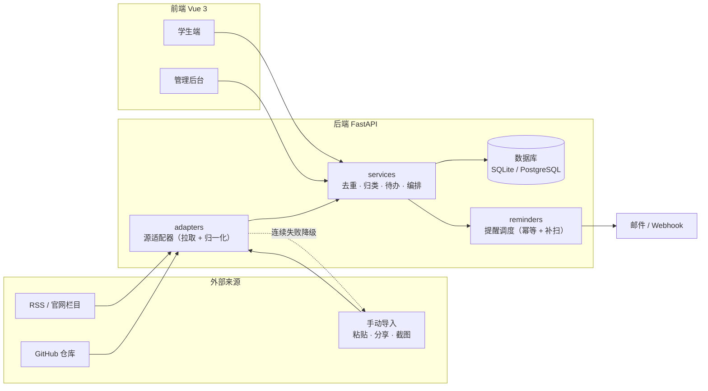

# 校园信息聚合与待办提醒系统

[](https://github.com/phao90016-jpg/Tongji-campus-notice-hub/actions/workflows/ci.yml)


> 把分散在学校官网、课程平台、GitHub 和班级群里的通知汇总到一个入口，
> 自动整理成可核对的待办并按时提醒——给同时跟多门课和多项校园事务的大学生用。

软件工程课程设计（CST3619 / 420146）项目仓库。

**一处看通知，一键转待办，到点有提醒。**

## 目录

- [项目状态](#项目状态)
- [问题与目标用户](#问题与目标用户)
- [功能范围](#功能范围)
- [角色与权限](#角色与权限)
- [外部集成点](#外部集成点)
- [架构](#架构)
- [增量与里程碑](#增量与里程碑)
- [技术栈](#技术栈)
- [仓库结构](#仓库结构)
- [文档导航](#文档导航)
- [本地运行](#本地运行)
- [工程约定](#工程约定)
- [团队](#团队)

## 项目状态

> **当前阶段：立项。** 文档骨架、Issue/PR 模板与 CI 已就位；业务代码尚未开工。

| 阶段 | 状态 | 产出 |
|---|---|---|
| 1 立项与选型 | ✅ 完成 | [选题文稿 v2](docs/00-立项/选题文稿.md)、[项目章程](docs/00-立项/项目章程.md) |
| 2 需求调研与规约 | ⏳ 进行中 | [调研计划表](docs/01-需求调研/调研计划表.md)、访谈纪要 |
| 3 需求建模 | ⬜ 未开始 | 用例图、类图、状态图 |
| 4 设计建模 | ⬜ 未开始 | 概要 / 详细设计、API 契约、ADR |
| 5 编码与配置管理 | ⬜ 未开始 | — |
| 6 迭代开发（2 轮） | ⬜ 未开始 | 迭代计划与回顾 |
| 7 测试 | ⬜ 未开始 | 测试计划、用例库、报告 |
| 8 交付演示 | ⬜ 未开始 | 部署系统、[演示脚本](docs/07-部署/演示脚本.md) |

## 问题与目标用户

大学生完成作业、参加竞赛和处理校园事务时要同时看多个平台。群通知容易被后续消息淹没，
作业或报名改期后容易沿用旧时间，分散在各平台的收藏也难以和手头的课程关联。

| 用户 | 说明 |
|---|---|
| **主要** | 需要跟进多门课程和校园事务的本科生 |
| 次要 | 发布班级 / 组织通知的班委与学生组织干事 |
| 次要 | 维护信息源的系统管理员 |

## 功能范围

**本期做（接入 → 归类 → 待办 → 提醒 → 归档）**

- 多源订阅与统一通知流：RSS / 官网栏目、GitHub 课程仓库、手动导入
- 去重、归类、截止时间提取（一律生成草稿，由用户确认）
- 待办确认与状态管理、提醒规则与推送
- 收藏与标签、搜索
- 三类角色的权限控制与管理后台

**本期明确不做**

- ❌ 微信群 / QQ 群自动接收 —— 个人微信无官方开放接口，改**手动导入**兜底
- ❌ 需登录的作业平台自动抓取 —— 涉及凭据托管与合规风险
- ❌ 内容平台截图 OCR 自动识别 —— 列为 v0.3 可选项
- ❌ 课程成绩、作业提交等学习管理功能 —— 与信息聚合边界重叠
- ❌ 支付类集成 —— 需企业资质，个人无法申请商户号

> 范围收敛的完整理由与替代方案见 [选题文稿 v2](docs/00-立项/选题文稿.md) 第四节。

## 角色与权限

| 角色 | 主要职责 | 数据权限边界 |
|---|---|---|
| 学生 `student` | 订阅信息源，管理自己的通知、待办与收藏 | 仅本人数据 |
| 班委 / 学生组织干事 `publisher` | 向所属班级或组织发布通知 | 仅本班 / 本组织 |
| 系统管理员 `admin` | 维护信息源与抓取任务，管理用户与角色 | 全局配置，不读待办正文 |
| 助教 / 教师（可选） | 发布课程通知，查看课程待办完成率 | 仅本课程聚合统计 |

权限模型：**RBAC + 资源归属校验**。越权访问统一返回 `403`，且不泄露资源是否存在。

## 外部集成点

| 集成点 | 用途 | 引入增量 |
|---|---|---|
| GitHub OAuth 2.0 | 第三方登录 | v0.1 |
| GitHub REST API | 读取课程仓库更新 | v0.1 |
| RSS / Atom | 订阅官网与竞赛栏目 | v0.1 |
| 邮件 SMTP / Webhook | 新消息与截止提醒 | v0.2 |

## 架构

前后端分离的分层架构，接入层使用**适配器模式**——把"源结构变化"的影响隔离在单个适配器内，
新增来源只加适配器、不改上层（对应风险 R1）。



**关键约束**：适配器不直接写库（保证去重幂等可单测）；状态迁移只能经 `services` 层。

## 增量与里程碑

| 增量 | 目标 | 演示重点 |
|---|---|---|
| **v0.1** | 多源 → 一条流 | 订阅 2 个源，10 秒内看到汇总通知 |
| **v0.2** | 通知 → 待办 → 提醒 | 现场造一条截止通知并收到提醒 |
| **v0.3** | 资料复用 + 管理后台 | 后台源维护与越权 403 演示 |

## 技术栈

| 层 | 选型 |
|---|---|
| 前端 | Vue 3 + TypeScript + Vite |
| 后端 | FastAPI（Python 3.11+） |
| 数据库 | 开发 SQLite / 部署 PostgreSQL |
| 调度 | 进程内定时任务（抓取、提醒） |
| 测试 | pytest + pytest-cov / Vitest |
| CI | GitHub Actions |

## 仓库结构

```
campus-notice-hub/
├── .github/
│   ├── ISSUE_TEMPLATE/      # 用户故事 / 缺陷 / 任务 三模板
│   ├── PULL_REQUEST_TEMPLATE.md
│   └── workflows/ci.yml     # ruff + pytest，红灯禁合并
├── docs/                    # 全部课程交付物（文档即代码）
│   ├── 00-立项/             # 选题文稿（含 v2 docx）、项目章程、选题 Issue
│   ├── 01-需求调研/         # 调研计划、访谈纪要、竞品分析、调研报告
│   ├── 02-需求规约/         # SRS、用户故事清单、变更记录、追溯矩阵
│   ├── 03-需求分析模型/     # 用例图、类图与 CRC、状态图与顺序图
│   ├── 04-设计/             # 概要/详细设计、数据库、API 契约、ADR
│   ├── 05-测试/             # 测试计划、用例库、验收用例、测试报告
│   ├── 06-迭代/             # 迭代计划与回顾
│   ├── 07-部署/             # 部署说明、演示脚本
│   ├── 08-AI使用/           # AI 使用报告与台账
│   ├── 09-评审/             # 评审单模板
│   └── 10-课堂讲解/         # 课堂讲解排期与讲稿
├── models/                  # 图源文件（Mermaid/PlantUML），一图一 PR
├── src/
│   ├── backend/             # FastAPI 后端（分层骨架）
│   └── frontend/            # Vue 3 前端（骨架）
└── scripts/                 # 造数与压测脚本（验证 NFR-1 / NFR-2）
```

## 文档导航

| 交付物 | 位置 | 检查点 |
|---|---|---|
| 选题文稿 | [md](docs/00-立项/选题文稿.md) · [docx](docs/00-立项/选题文稿-v2.docx) | 第 1 次课 |
| 项目章程 | [项目章程](docs/00-立项/项目章程.md) | 第 1 次课 |
| 选题 Issue 正文 | [选题Issue](docs/00-立项/选题Issue.md) | 第 1 次课 |
| 调研计划表 | [调研计划表](docs/01-需求调研/调研计划表.md) | 第 1 次课 |
| 调研报告 | [调研报告](docs/01-需求调研/调研报告.md) | 第 2 次课 |
| 用户故事清单 | [用户故事清单](docs/02-需求规约/用户故事清单.md) | 第 2 次课 |
| 需求规约 SRS | [SRS-v1.0](docs/02-需求规约/SRS-v1.0.md) | 第 3 次课 |
| 需求追溯矩阵 | [需求追溯矩阵](docs/02-需求规约/需求追溯矩阵.md) | 第 3 / 5 次课 |
| 分析模型 | [用例图](docs/03-需求分析模型/用例图.md) · [类图](docs/03-需求分析模型/类图与CRC.md) · [状态图](docs/03-需求分析模型/状态图与顺序图.md) | 第 4 / 5 次课 |
| 概要设计 | [概要设计](docs/04-设计/概要设计.md) | 第 6 次课 |
| 详细设计 | [详细设计](docs/04-设计/详细设计.md) | 第 7 次课 |
| 测试计划与报告 | [05-测试/](docs/05-测试/) | 第 7 次课起 |
| 演示脚本 | [演示脚本](docs/07-部署/演示脚本.md) | 期末 |
| AI 使用报告 | [AI使用报告](docs/08-AI使用/AI使用报告.md) | 期末 |

完整索引与"十项交付物"对照见 **[docs/README.md](docs/README.md)**。

## 本地运行

> 骨架期仅可验证后端健康检查；完整启动步骤在 v0.1 首个 PR 补齐。

```bash
# 后端
cd src/backend
python -m venv .venv
source .venv/bin/activate          # Windows: .venv\Scripts\activate
pip install -r requirements-dev.txt
cp .env.example .env               # 填写密钥；.env 不提交
pytest -q                          # 应全绿
uvicorn app.main:app --reload      # http://localhost:8000/health

# 前端
cd src/frontend
npm install
npm run dev
```

## 工程约定

完整工作流见 **[CONTRIBUTING.md](CONTRIBUTING.md)**，要点：

- `main` 受保护，**禁止直推**，一律走 Pull Request
- 每个 PR 至少 1 人 Review + CI 绿灯方可合并（**人守关卡**）
- 需求、缺陷、任务一律先建 Issue；变更走"申请 → 评审 → 批准 → 关闭"
- AI 产出必须登记到 [AI 使用台账](docs/08-AI使用/AI使用台账.md)，密钥与个人数据严禁进入提示词
- 禁止"最后一晚打包上传"式提交，提交分布计入过程成绩

## 团队

| 成员 | 课程角色 | 兼任 |
|---|---|---|
| 待填 | 项目经理 | |
| 待填 | 需求分析师 | |
| 待填 | 架构 / 设计工程师 | |
| 待填 | 开发工程师 | |
| 待填 | 测试 / 质量工程师 | |
| 待填 | — | AI 使用负责人 |
| 待填 | — | DevOps 负责人 |

> 每人至少主讲 1 次课堂讲解、至少 10 个被合并的 PR。排期见
> [课堂讲解排期](docs/10-课堂讲解/讲解排期.md)。
