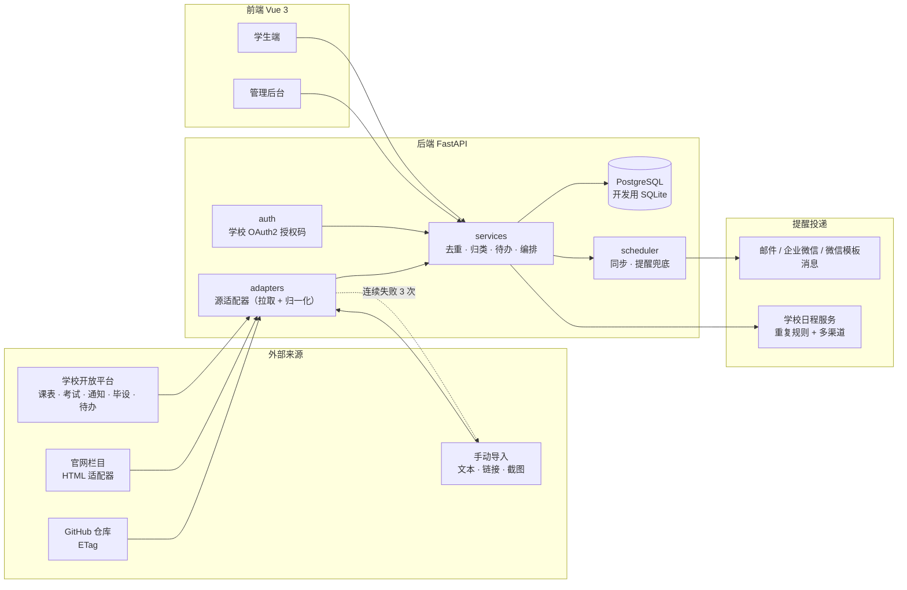

# 校园待办中心 · Tongji Campus Notice Hub

[](https://github.com/phao90016-jpg/Tongji-campus-notice-hub/actions/workflows/ci.yml)


> 把学校教务系统里本来就有的课表、考试、毕设节点和通知，连同官网公告、GitHub 仓库和手动导入的内容，汇成一个入口，直接生成可核对的待办，并按你设定的提前量提醒。

软件工程课程设计（CST3619 / 420146）项目仓库。

---

## 这个项目解决什么

学生漏事，通常不是因为"没有聚合"，而是因为**关键时间点散在教务系统的不同页面里，且没有任何一处会主动找你**。

| 现象 | 现在怎么做 | 代价 |
|---|---|---|
| 考试时间地点只在排考页面 | 截图、记在备忘录 | 考场临时调整，按旧信息跑错楼 |
| 每学期课表要手工敲进日历 | 对着教务系统一条条录 | 8–12 门课，换教室后日历就废了 |
| 毕设选题/中期/预答辩三个节点 | 等群里通知、问同学 | 错过中期考核只能延毕设 |
| 一网通办申请卡在某个节点 | 反复登录看 | 不知道在等谁，也不知道还剩几天 |
| 班委发通知 | 群里刷屏 + 手动数谁没回 | 阅读率靠猜 |

**这个项目做的事**：把这些"已经在系统里、但没人提醒你"的时间点，变成手机上会响的待办。

### 三个设计判断

1. **主源是校内结构化接口，不是网页抓取。**考试接口直接给 `examDate` + `examStartTime` + `roomName`，比从通知正文里猜时间可靠一个数量级。
2. **结构化数据不强迫用户确认。**考试、课表、毕设节点生成的待办直接可用；只有从通知正文抽取的才走"草稿 → 用户确认"。
3. **提醒投递外包给学校日程服务，本地只做兜底。**日程接口自带重复规则（每周上课）与多渠道提醒（站内/邮件/企业微信/微信），不必自己造调度器。

---

## 功能

### 1. 校内数据接入

| 能力 | 用户看到什么 | 数据来源 |
|---|---|---|
| 学校统一身份认证登录 | 用学校账号登录，不用另设密码 | OAuth2 授权码 + `kc_idp_hint=tjiam` |
| 首次登录自动同步 | 登录后 10 秒内看到本周课表、考试、通知 | 课表 / 考试 / 教务通知 / 毕设节点 / 一网通办待办 |
| 课表同步 | "周三 3–4 节 数据结构 · 嘉定 A301" | `weekday`/`startUnit`/`endUnit`/`week`/`classroomName` |
| 考试同步 | "12-30 13:30 材料科学基础2 · 博楼 B110" | `examDate`/`examStartTime`/`roomName` |
| 毕设节点同步 | 选题、中期考核、预答辩各一条待办 | `topicTime`/`assessTime`/`defenseDate` |
| 一网通办待办导入 | 已有申请直接进待办列表 | `taskId`/`nodeName`/`formUrl` |

### 2. 补充源

| 能力 | 说明 |
|---|---|
| 官网栏目订阅 | HTML 适配器（**同济站点没有 RSS**），每源一份配置：列表页、条目选择器、正文选择器 |
| GitHub 仓库订阅 | 公开 REST API + ETag 条件请求，无更新时返回 304、不产生新通知 |
| 手动导入 | 粘贴文本 / 粘贴链接 / 上传截图，生成 `origin=manual` 的通知 |

### 3. 通知流与归类

- 四类来源合并为一条时间线，按来源、类型、课程、未读筛选，游标分页
- 按课程名 / 课程号 / 教师名把通知归到课程，匹配不中归"未分类"
- 同一业务主键的内容哈希变化 → 生成"原文已变更，请核对"，**不覆盖你改过的待办**

### 4. 待办

| 类型 | 生成方式 | 是否需要确认 |
|---|---|---|
| 考试、补缓考、上课、毕设、实习、一网通办、图书催还 | 结构化数据直接生成，`auto_confirmed=true` | 否 |
| 通知里提到的截止事项 | 规则 + 抽取生成草稿，保留原文高亮 | **是**，用户确认后才进列表 |
| 手动新建 | 用户自己写 | — |

状态机：`草稿 → 已确认 → 进行中 → 已完成`，可转`已过期`/`已取消`；每次迁移写状态日志，非法迁移返回 409。

### 5. 提醒

- 每类待办设默认提前量（5 / 15 / 30 / 60 / 1440 分钟）与渠道，单条可覆盖
- 已确认待办写入学校日程（带重复规则、`remindTimes`、`remindChannel`、回链 `linkUrl`）
- 本地同时落一条提醒任务，用于平台不可用时兜底，以及 ±60s 准点率验收

### 6. 资料与后台

- 收藏文本/链接/截图，加标签、关联课程，全文检索（SQLite FTS5 / PG `tsvector`）
- 班委发布班级通知 + 阅读率统计
- 管理员：源与同步任务健康度、手动触发、失败告警；用户与角色；审计日志

---

## 数据来源

功能点全部锚定在已存在的接口上。字段取自接口文档的返回参数表，不是推测。

| 数据 | 接口 | 授权 | 关键字段 |
|---|---|---|---|
| 课表 | `GET /v2/dc/teaching_info/student_timetable` | 客户端 / 授权码 | `weekday`、`startUnit`、`endUnit`、`week`、`classroomName`、`delInd` |
| 期末考试 | `GET /v1/rt/teaching_info/absent_examinfo` | 客户端 | `examDate`、`examStartTime`、`roomName`、`examStatus` |
| 补缓考 | `GET /v1/rt/teaching_info/deferred_examinfo` | 客户端 | 同上，`examType=2` |
| 教务通知 | `GET /v1/rt/onetongji/msg_list` · `msg_detail` | 客户端 | `title`、`content`、`publishTime`、`faceUserName` |
| 学年学期 | `GET /v1/rt/teaching_info/semester` | **匿名** | `beginDay`、`endDay`、`examWeekStart/End` |
| 毕设节点 | `thesis_topic` · `midterm_assessment` · `pre_defense` | 客户端 / 授权码 | `topicTime`、`assessTime`、`defenseDate` + 地点 |
| 一网通办待办 | `GET /v1/infra/task_center/task_list` | 客户端 / 授权码 | `taskId`、`nodeName`、`formUrl` |
| 个人日程 | `POST /v1/infra/calendar/person/create` | 客户端 / 授权码 | `eventRepeatType`、`remindTimes`、`remindChannel` |
| 消息推送 | `notification/email` · `wecom` · `mp` · `sms` | 客户端（部分含授权码） | `userId`、`content`、`time` |
| GitHub | `GET /repos/{owner}/{repo}/commits` | 公开 REST | `sha`、`commit.message`、`commit.author.date` |
| 官网栏目 | 本科生院 `/30359/list.htm` 等 | 公开页面 | 列表条目、`div.wp_articlecontent` |

**三条硬事实**（详见 [可行性探测报告](docs/00-立项/可行性探测报告.md)）：

1. 教务通知接口**没有任何参数**（目录中 `parameters=null`），返回全校通知，需按 `faceUserName` 过滤；`startTime/endTime` 是展示有效期，不是办理截止时间。
2. 校历接口不可用（`A07500`），但学期接口匿名可用（66 个学期），周次换算没问题。
3. 考试与课表接口要求先取 `calendarId`（当前学期编号），"查考试"实际是两步。

---

## 角色与权限

| 角色 | 职责 | 数据边界 |
|---|---|---|
| 学生 `student` | 看通知与待办、管自己的提醒与收藏 | 仅本人 |
| 班委 `publisher` | 向所属班级发布通知、看阅读率 | 仅本班 / 本组织 |
| 管理员 `admin` | 维护源与同步任务、管理用户与角色 | 全局配置；审计只记元数据，不读待办正文 |
| 教师（可选，v0.3） | 发布课程通知、看课程待办完成率 | 仅本课程聚合，不读个人明细 |

**校内接口的调用约束**（重要）：

- 支持授权码模式的接口 → 一律用当前登录用户的 token，`userId` 从 token 取，不接受前端传入
- 仅客户端模式的接口（考试、教务通知、企业微信）→ 后端以应用身份调用，但入参 `userId` 必须等于当前登录用户，代码层断言 + 审计
- 越权访问统一返回 `403`，且不泄露资源是否存在

---

## 架构



**关键约束**

- 适配器不直接写库（去重幂等可单测）；状态迁移只能经 `services` 层
- 幂等用**业务主键**（`UNIQUE(source, external_id)`），不用内容哈希；哈希只用于检测改期
- 不预拉全校数据：只对已授权用户按需同步 + 本地缓存，避免把他人明细落库

---

## 增量与里程碑

| 增量 | 目标 | 交付内容 | 演示重点 |
|---|---|---|---|
| **v0.1** | 校内数据 → 一条流 | 学校 OAuth 登录、课表/考试/通知/毕设同步、官网 1 个适配器、GitHub 订阅、手动导入、通知流与去重 | 新账号登录后 10 秒看到"本周课表 + 考试 + 通知" |
| **v0.2** | 结构化待办 → 提醒 | 七类结构化待办、文本草稿与确认、状态机、提醒规则、日程写入、多渠道推送、改期提示 | 改一条考场，日程与提醒更新并收到核对提示 |
| **v0.3** | 资料复用 + 管理面 | 收藏/标签/搜索、班委发布与阅读统计、源与同步任务监控、RBAC、审计、越权 403 | 双账号越权演示 + 后台源健康度与降级 |

**并行任务**：第 1 周完成开放平台应用登记与 scope 申请、OAuth 回调地址备案。审批未到位时，v0.1 用"手动导入 + 官网 + GitHub"三条零依赖路径演示，校内接口以 mock 响应驱动开发。

---

## 技术栈

| 层 | 选型 | 说明 |
|---|---|---|
| 前端 | Vue 3 + TypeScript + Vite | 学生端与管理后台同仓 |
| 后端 | FastAPI（Python 3.11+） | 分层：`api` / `services` / `adapters` / `models` |
| 数据库 | 开发 SQLite / 部署 PostgreSQL | 全文检索分别用 FTS5 / `tsvector` |
| 调度 | 进程内调度 + 任务落库 | 同步任务与提醒兜底，启动补扫 |
| 测试 | pytest + pytest-cov / Vitest | 适配器与状态机必须有单测 |
| CI | GitHub Actions | ruff + pytest，红灯禁合并 |

---

## 快速开始

```bash
# 后端
cd src/backend
python -m venv .venv
source .venv/bin/activate          # Windows: .venv\Scripts\activate
pip install -r requirements-dev.txt
cp .env.example .env               # 填写 client_id / secret；.env 不提交
pytest -q                          # 应全绿
uvicorn app.main:app --reload      # http://localhost:8000/health

# 前端
cd src/frontend
npm install
npm run dev
```

### 可行性探测（可复跑）

立项阶段对全部数据源做了实测，脚本与结果在 [`probe/`](probe/)：

```bash
cd probe
python3 probe_feasibility.py --json     # 9 项实测：token / 匿名接口 / scope / GitHub ETag / RSS / 官网解析
python3 scrape_inventory.py             # 抓取 235 个接口文档页，产出 api_inventory.csv
```

结论：235 个接口中 22 个匿名、80 个仅客户端、124 个支持授权码；官网无 RSS；校历接口故障；GitHub ETag 返回 304。详见 [可行性探测报告](docs/00-立项/可行性探测报告.md)。

---

## 仓库结构

```
campus-notice-hub/
├── .github/
│   ├── ISSUE_TEMPLATE/      # 用户故事 / 缺陷 / 任务
│   ├── PULL_REQUEST_TEMPLATE.md
│   └── workflows/ci.yml     # ruff + pytest，红灯禁合并
├── docs/                    # 课程交付物（文档即代码）
│   ├── 00-立项/             # 选题文稿 v3（md + docx）、可行性探测报告、项目章程
│   ├── 01-需求调研/         # 调研计划、访谈纪要、竞品分析、调研报告
│   ├── 02-需求规约/         # SRS、用户故事清单、变更记录、追溯矩阵
│   ├── 03-需求分析模型/     # 用例图、类图与 CRC、状态图与顺序图
│   ├── 04-设计/             # 概要/详细设计、数据库、API 契约、ADR
│   ├── 05-测试/             # 测试计划、用例库、验收用例、测试报告
│   ├── 06-迭代/             # 迭代计划与回顾
│   ├── 07-部署/             # 部署说明、演示脚本
│   ├── 08-AI使用/           # AI 使用报告与台账
│   ├── 09-评审/             # 评审单模板
│   └── 10-课堂讲解/         # 课堂讲解排期与讲稿
├── models/                  # 图源文件（Mermaid/PlantUML），一图一 PR
├── probe/                   # 可行性探测：脚本 + 接口清单 + 结果
├── scripts/                 # 造数与压测；md2docx.py 由 Markdown 生成 docx
├── src/
│   ├── backend/             # FastAPI 后端（分层骨架）
│   └── frontend/            # Vue 3 前端（骨架）
└── README.md
```

---

## 文档导航

| 交付物 | 位置 | 检查点 |
|---|---|---|
| 选题文稿 v3 | [md](docs/00-立项/选题文稿.md) · [docx](docs/00-立项/选题文稿-v3.docx) | 第 1 次课 |
| 可行性探测报告 | [可行性探测报告](docs/00-立项/可行性探测报告.md) | 第 1 次课 |
| 选题变更说明 | [变更说明-选题v3](docs/00-立项/变更说明-选题v3.md) | 第 1 次课 |
| 项目章程 | [项目章程](docs/00-立项/项目章程.md) | 第 1 次课 |
| 调研计划表 | [调研计划表](docs/01-需求调研/调研计划表.md) | 第 1 次课 |
| 调研报告 | [调研报告](docs/01-需求调研/调研报告.md) | 第 2 次课 |
| 用户故事清单 | [用户故事清单](docs/02-需求规约/用户故事清单.md) | 第 2 次课 |
| 需求规约 SRS | [SRS-v1.0](docs/02-需求规约/SRS-v1.0.md) | 第 3 次课 |
| 需求追溯矩阵 | [需求追溯矩阵](docs/02-需求规约/需求追溯矩阵.md) | 第 3 / 5 次课 |
| 分析模型 | [用例图](docs/03-需求分析模型/用例图.md) · [类图](docs/03-需求分析模型/类图与CRC.md) · [状态图](docs/03-需求分析模型/状态图与顺序图.md) | 第 4 / 5 次课 |
| 概要 / 详细设计 | [概要设计](docs/04-设计/概要设计.md) · [详细设计](docs/04-设计/详细设计.md) | 第 6 / 7 次课 |
| 测试计划与报告 | [05-测试/](docs/05-测试/) | 第 7 次课起 |
| 演示脚本 | [演示脚本](docs/07-部署/演示脚本.md) | 期末 |
| AI 使用报告 | [AI使用报告](docs/08-AI使用/AI使用报告.md) | 期末 |

完整索引与"十项交付物"对照见 **[docs/README.md](docs/README.md)**。

---

## 工程约定

完整工作流见 **[CONTRIBUTING.md](CONTRIBUTING.md)**，要点：

- `main` 受保护，**禁止直推**，一律走 Pull Request
- 每个 PR 至少 1 人 Review + CI 绿灯方可合并
- 需求、缺陷、任务一律先建 Issue；变更走"申请 → 评审 → 批准 → 关闭"
- AI 产出必须登记到 [AI 使用台账](docs/08-AI使用/AI使用台账.md)；密钥、token、学工号严禁进入代码仓库与提示词
- 文档改动同时更新 Markdown 与 docx（`python3 scripts/md2docx.py docs/00-立项/选题文稿.md docs/00-立项/选题文稿-v3.docx --template docs/00-立项/选题文稿-v2.docx`）
- 禁止"最后一晚打包上传"式提交，提交分布计入过程成绩

---

## 团队

| 成员 | 课程角色 | 兼任 |
|---|---|---|
| 待填 | 项目经理 | |
| 待填 | 需求分析师 | |
| 待填 | 架构 / 设计工程师 | |
| 待填 | 开发工程师 | |
| 待填 | 测试 / 质量工程师 | |
| 待填 | — | AI 使用负责人 |
| 待填 | — | DevOps 负责人 |

> 每人至少主讲 1 次课堂讲解、至少 10 个被合并的 PR。排期见
> [课堂讲解排期](docs/10-课堂讲解/讲解排期.md)。
