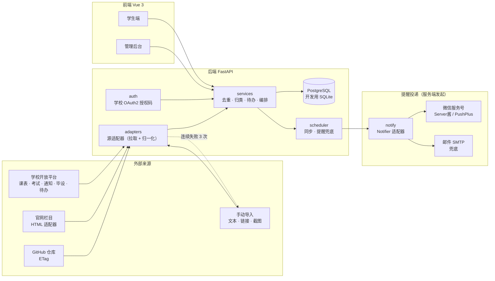

# 校园待办中心 · Tongji Campus Notice Hub

[](https://github.com/phao90016-jpg/Tongji-campus-notice-hub/actions/workflows/ci.yml)


> 把学校教务系统里本来就有的课表、考试、毕设节点和通知，连同官网公告、GitHub 仓库和手动导入的内容，汇成一个入口，直接生成可核对的待办，并按你设定的提前量提醒。

软件工程课程设计（CST3619 / 420146）项目仓库。

---

## 这个项目解决什么

### 一个学生的周三

| 时间 | 他在干什么 | 卡在哪 |
|---|---|---|
| 7:40 | 出门前想确认今天 3–4 节在哪上课 | 上周换过教室，记不清是嘉定 A301 还是四平 |
| 10:00 | 群里 200+ 条消息，想找老师昨天说的"周五交第 5 章习题" | 翻不到，也不敢问 |
| 14:00 | 同学问"毕设中期是不是下个月" | 系统里写着 11-28，但没有任何地方提醒过他 |
| 20:00 | 想起奖学金申请提交了 | 不知道卡在学院还是学校，也不知道还剩几天 |
| 23:00 | 想"这周还剩什么没做" | 只能靠回忆，回忆不准 |

这四类时间点——课程、考试、毕设／实习、校务流程——分属不同系统、不同页面，**没有任何一个会在到期前主动找他**。

### 五件事，漏一次就够呛

| 事 | 现在怎么知道 | 漏了会怎样 | 为什么拦不住 |
|---|---|---|---|
| 考场临时变更 | 登教务系统看排考 | 跑错楼，迟到太久不让进 | 日历里存的是旧教室，不会自动更新 |
| 毕设中期考核 | 群里通知、问同学 | 错过考核，毕设延期 | 没有统一入口，消息会被刷走 |
| 选课／退课截止 | 教务通知 | 抢不到课、退不掉课 | 通知在官网，要主动去看 |
| 作业提交 | 老师口头、群消息 | 平时分扣光 | 群消息一天几百条，昨天的被淹没 |
| 一网通办卡在某个节点 | 反复登录查 | 材料过期，重走流程 | 没有"在等谁、还剩几天"的提示 |

### 现有工具为什么不够

| 工具 | 它解决了 | 它没解决 |
|---|---|---|
| 手机日历 | 会响 | 要一条条手工录；教务改时间不会同步；不知道考场 |
| 备忘录 | 能记 | 不会响，记了也白记 |
| 班级群 | 信息源 | 会淹没；无法跟踪谁还没交 |
| 教务系统 | 权威数据 | 要主动查；没有提醒 |
| 聚合类 App | 把通知放在一起 | 只聚合不生成待办；不接校内结构化数据 |

### 这个项目怎么做

```
① 拉齐          ② 变成待办              ③ 推到你手机上
课表/考试/通知 → 结构化数据直接生成      → 服务端到点投递
毕设/实习/待办    作业自己登记              → 微信服务号
官网/GitHub      通知抽取的生成草稿        → 失败降级邮件
```

1. **拉齐**：登录后从学校接口拉课表、考试、教务通知、毕设节点、一网通办待办；官网栏目与 GitHub 仓库作为补充源，进入同一条通知流。
2. **变成待办**：考试、上课、毕设、实习、待办导入这些结构化数据**直接生成、无需确认**；作业由学生自己登记；只有从通知正文抽取的才生成草稿等用户确认。
3. **推到你手机上**：服务端到点投递到微信服务号，手机在「服务通知」里响；服务号失败自动降级到邮件，再不行落到站内。

### 三个设计判断

1. **主源是校内结构化接口，不是网页抓取。** 考试接口直接给 `examDate` + `examStartTime` + `roomName`，比从通知正文里猜时间可靠一个数量级；猜出来的时间错了，比没有更糟。
2. **结构化数据不强迫用户确认。** 考试、课表、毕设节点生成的待办直接可用；只有从通知正文抽取的才走"草稿 → 用户确认"。让用户逐条确认 8 门课的 40 次课，等于逼他放弃。
3. **提醒由服务端直接投递到微信，不依赖学校渠道，也不依赖客户端常驻。** 学生绑定一次微信服务号，之后到点由服务端发一条 HTTPS 请求，手机在微信「服务通知」里响；服务号失败自动降级到邮件。

---

## 功能

六组功能、22 项功能需求，分三个增量交付。详细规约见 [选题文稿](docs/00-立项/选题文稿.md) 第三节。

| 组 | 解决什么 | 关键能力 | 增量 |
|---|---|---|---|
| 1 校内数据接入 | 数据从哪来 | 学校登录、课表、考试、毕设、实习、一网通办待办 | v0.1 |
| 2 补充源 | 校内接口没有的内容 | 官网栏目、GitHub 仓库、手动导入 | v0.1 |
| 3 通知流与归类 | 看什么 | 统一时间线、按课程归类、改期检测 | v0.1 |
| 4 待办 | 做什么、什么时候做 | 结构化自动生成、作业登记、草稿确认、状态机 | v0.2 |
| 5 提醒 | 别忘了 | 渠道绑定、多通道降级、投递记录 | v0.2 |
| 6 资料与后台 | 找回来、管起来 | 收藏检索、班级发布、源监控、RBAC 与审计 | v0.3 |

### 1. 校内数据接入

| 能力 | 具体行为 | 数据来源 |
|---|---|---|
| 学校统一身份认证登录 | OAuth2 授权码，回调换 token，解析学工号；不新建密码体系 | `kc_idp_hint=tjiam` |
| 首次登录自动同步 | 五路并发拉取，前端先出骨架屏，各路完成即填充；单路失败可单独重试 | 课表 / 考试 / 通知 / 毕设 / 待办 |
| 课表同步 | 展开为"课程 + 节次"两级；`delInd='D'`（退课）从周视图移除但保留历史 | `weekday`、`startUnit`、`endUnit`、`week`、`classroomName` |
| 考试同步 | 含日期、起止时间、考场、课程、任课教师；未排考场时只显示时间与课程 | `examDate`、`examStartTime`、`roomName`、`examStatus` |
| 补缓考同步 | 与期末考试同一套结构，`examType=2` 区分 | `deferred_examinfo` |
| 毕设节点同步 | 选题、中期考核、预答辩各生成一条；时间或地点缺失时保留待办、该字段留空 | `topicTime`、`assessTime`、`defenseDate` |
| 实习课程同步 | 起止日期与实习天数 | `courseDateStart/End` |
| 一网通办待办导入 | 把已有申请导入待办，附办理入口 | `taskId`、`nodeName`、`formUrl` |
| 学期与周次 | 匿名接口取 66 个学期，用于"第 12 周"换算成具体日期 | `teaching_info/semester` |

### 2. 补充源

| 能力 | 具体行为 | 边界 |
|---|---|---|
| 官网栏目订阅 | 每源一份配置：列表页、条目选择器、正文选择器、日期格式；连续失败 3 次自动降级为"仅手动导入"并告警 | 同济站点没有 RSS，只能按站点写适配器；本科生院是 HTML 正文，计算机学院是 PDF 图片（仅展示原文） |
| GitHub 仓库订阅 | 拉 `commits` 与 `releases`，带 ETag 条件请求；无更新返回 304，不产生通知、不消耗配额 | 未授权配额 60 次/小时/IP，部署时配 Token |
| 手动导入 | 粘贴文本、粘贴链接、上传截图，生成 `origin=manual` 的通知，进入同一条流 | 截图先存图，文字由用户补；OCR 不在本期 |

### 3. 通知流与归类

| 能力 | 具体行为 |
|---|---|
| 统一时间线 | 校内通知、官网公告、GitHub 更新、手动导入合并；按来源、类型、课程、未读筛选；游标分页 |
| 归类 | 按课程名 / 课程号 / 教师名把通知归到课程；匹配不中归"未分类"，不硬猜 |
| 去重 | `UNIQUE(source, external_id)`；重复同步只留一条 |
| 改期与撤回 | 同一业务主键的内容哈希变化 → 生成"原文已变更，请核对"，**不覆盖你改过的待办**；撤回的通知标灰、不再提醒 |

### 4. 待办

八类来源，三种进入方式：

| 来源 | 进入方式 | 是否确认 | 典型内容 |
|---|---|---|---|
| 期末考试、补缓考 | 结构化数据直接生成 | 否 | "12-30 13:30 材料科学基础2 · 博楼 B110" |
| 上课 | 结构化 + 每周重复 | 否 | "每周三 3–4 节 数据结构 · 嘉定 A301" |
| 毕设节点 | 结构化数据直接生成 | 否 | "11-28 14:00 中期考核 · 学院 314" |
| 实习 | 结构化数据直接生成 | 否 | "7-04 至 7-15 数据结构课程设计" |
| 一网通办 | 导入已有待办 | 否 | "奖学金申请 · 卡在学院审核" |
| 图书催还 | 结构化数据直接生成 | 否 | "《算法导论》已催还" |
| **课程作业** | **学生自助登记** | 否 | "第 5 章习题 · 周五 23:59 前交" |
| 通知里提到的截止事项 | 规则 + 抽取生成草稿 | **是** | "9 月 27 日前提交材料" |

**作业为什么要自己登记**：学校没有作业接口（237 个接口里"作业"命中 0 个）。所以作业按"课程 + 标题 + 截止时间 + 提交方式"录入，支持从通知一键转作业、同课程复用上次填写；逾期未完成标红，同课程同标题重复登记时提示合并而不是新建。

**状态机**：`草稿 → 已确认 → 进行中 → 已完成`，可转 `已过期` / `已取消`；每次迁移写状态日志，非法迁移返回 409。结构化来源直接落"已确认"，不让用户空转。

### 5. 提醒

提醒由服务端投递：不依赖学校接口是否真的发消息，也不依赖网页开着。

| 环节 | 做法 |
|---|---|
| 绑定 | 学生扫码关注微信服务号（Server酱 / PushPlus），把 SendKey 粘进「我的 → 通知渠道」，系统立即发一条测试消息验证 |
| 投递 | 到点按「主通道 → 兜底」顺序发送：微信服务号 → 邮件 → 站内，任一成功即止 |
| 失败 | 凭据失效、网络错误、服务商业务错误分别归类；网络错误重试 2 次，仍失败 3s 内降级，投递记录标红 |
| 记录 | 每次尝试写一条（通道、耗时、结果码），后台可查每条待办实际走了哪条通道 |
| 日程 | 已确认待办可同步到校园号日程，方便在日历里看到（可选，不承诺提醒） |

**默认提醒规则**（可按类型改、单条可覆盖）：

| 类型 | 默认提前量 |
|---|---|
| 考试 | 提前 1 天 + 提前 2 小时 |
| 上课 | 提前 15 分钟 |
| 作业 | 提前 1 天 20:00 + 当天 18:00 |
| 毕设节点 | 提前 3 天 + 提前 1 天 |
| 其他 | 提前 1 天 |

准点率验收的是**服务端发出请求的时间**（计划时间 ±60s）；到达时间由服务商决定，不计入验收。

### 6. 资料与后台

| 能力 | 具体行为 |
|---|---|
| 收藏与检索 | 收藏文本 / 链接 / 截图，加标签、关联课程；全文检索覆盖标题、正文、备注 |
| 班级发布 | 班委向所属班级发布通知，记阅读回执，给出阅读率（已读 / 班级人数） |
| 源与任务监控 | 每个源的最近同步时间、成功失败次数、健康度；可手动触发、可暂停；失败 3 次标红并降级 |
| 用户与角色 | RBAC + 归属校验；越权统一 403 且不泄露资源是否存在 |
| 审计 | 管理操作记元数据（操作人、动作、对象），不记待办正文 |

---

## 数据来源

功能点全部锚定在已存在的接口上。字段取自接口文档的返回参数表，不是推测。

| 数据 | 接口 | 授权 | 关键字段 |
|---|---|---|---|
| 课表 | `GET /v2/dc/teaching_info/student_timetable` | 客户端 / 授权码 | `weekday`、`startUnit`、`endUnit`、`week`、`classroomName`、`delInd` |
| 期末考试 | `GET /v1/rt/teaching_info/absent_examinfo` | 客户端 | `examDate`、`examStartTime`、`roomName`、`examStatus` |
| 补缓考 | `GET /v1/rt/teaching_info/deferred_examinfo` | 客户端 | 同上，`examType=2` |
| 教务通知 | `GET /v1/rt/onetongji/msg_list` · `msg_detail` | 客户端 | `title`、`content`、`publishTime`、`faceUserName` |
| 学年学期 | `GET /v1/rt/teaching_info/semester` | **匿名** | `beginDay`、`endDay`、`examWeekStart/End` |
| 毕设节点 | `thesis_topic` · `midterm_assessment` · `pre_defense` | 客户端 / 授权码 | `topicTime`、`assessTime`、`defenseDate` + 地点 |
| 一网通办待办 | `GET /v1/infra/task_center/task_list` | 客户端 / 授权码 | `taskId`、`nodeName`、`formUrl` |
| 提醒投递 | Server酱 / PushPlus HTTPS 接口 | 用户 SendKey / Token | `title`、`desp`、`token` |
| 个人日程（可选） | `POST /v1/infra/calendar/person/create` | 客户端 / 授权码 | `eventRepeatType`、`remindTimes`、`linkUrl` |
| GitHub | `GET /repos/{owner}/{repo}/commits` | 公开 REST | `sha`、`commit.message`、`commit.author.date` |
| 官网栏目 | 本科生院 `/30359/list.htm` 等 | 公开页面 | 列表条目、`div.wp_articlecontent` |

> 学校消息服务（邮件 / 企业微信 / 模板消息）与个人日程只作为可选增强：写进去的日程不一定会触发提醒，模板消息需要用户关注并授权，因此提醒主链路不依赖它们。通道设计见 [通知通道](docs/04-设计/通知通道.md)。

**三条硬事实**（详见 [可行性探测报告](docs/00-立项/可行性探测报告.md)）：

1. 教务通知接口**没有任何参数**（目录中 `parameters=null`），返回全校通知，需按 `faceUserName` 过滤；`startTime/endTime` 是展示有效期，不是办理截止时间。
2. 校历接口不可用（`A07500`），但学期接口匿名可用（66 个学期），周次换算没问题。
3. 考试与课表接口要求先取 `calendarId`（当前学期编号），"查考试"实际是两步。

---

## 角色与权限

| 角色 | 职责 | 数据边界 |
|---|---|---|
| 学生 `student` | 看通知与待办、管自己的提醒与收藏 | 仅本人 |
| 班委 `publisher` | 向所属班级发布通知、看阅读率 | 仅本班 / 本组织 |
| 管理员 `admin` | 维护源与同步任务、管理用户与角色 | 全局配置；审计只记元数据，不读待办正文 |
| 教师（可选，v0.3） | 发布课程通知、看课程待办完成率 | 仅本课程聚合，不读个人明细 |

**校内接口的调用约束**（重要）：

- 支持授权码模式的接口 → 一律用当前登录用户的 token，`userId` 从 token 取，不接受前端传入
- 仅客户端模式的接口（考试、教务通知）→ 后端以应用身份调用，但入参 `userId` 必须等于当前登录用户，代码层断言 + 审计
- 越权访问统一返回 `403`，且不泄露资源是否存在

---

## 架构



**关键约束**

- 适配器不直接写库（去重幂等可单测）；状态迁移只能经 `services` 层
- 幂等用**业务主键**（`UNIQUE(source, external_id)`），不用内容哈希；哈希只用于检测改期
- 不预拉全校数据：只对已授权用户按需同步 + 本地缓存，避免把他人明细落库

---

## 增量与里程碑

| 增量 | 目标 | 交付内容 | 演示重点 |
|---|---|---|---|
| **v0.1** | 校内数据 → 一条流 | 学校 OAuth 登录、课表/考试/通知/毕设同步、官网 1 个适配器、GitHub 订阅、手动导入、通知流与去重 | 新账号登录后 10 秒看到"本周课表 + 考试 + 通知" |
| **v0.2** | 结构化待办 → 提醒 | 七类结构化待办、文本草稿与确认、状态机、提醒规则、服务号绑定与投递、邮件兜底、投递记录、改期提示 | 确认一条待办，关掉网页，手机微信收到提醒；把 SendKey 改错再触发，自动降级到邮件 |
| **v0.3** | 资料复用 + 管理面 | 收藏/标签/搜索、班委发布与阅读统计、源与同步任务监控、RBAC、审计、越权 403 | 双账号越权演示 + 后台源健康度与降级 |

**并行任务**：第 1 周完成开放平台应用登记与 scope 申请、OAuth 回调地址备案。审批未到位时，v0.1 用"手动导入 + 官网 + GitHub"三条零依赖路径演示，校内接口以 mock 响应驱动开发。

---

## 技术栈

| 层 | 选型 | 说明 |
|---|---|---|
| 前端 | Vue 3 + TypeScript + Vite | 学生端与管理后台同仓 |
| 后端 | FastAPI（Python 3.11+） | 分层：`api` / `services` / `adapters` / `notify` / `models` |
| 数据库 | 开发 SQLite / 部署 PostgreSQL | 全文检索分别用 FTS5 / `tsvector` |
| 调度 | 进程内调度 + 任务落库 | 同步任务与提醒投递，启动补扫 |
| 测试 | pytest + pytest-cov / Vitest | 适配器、通道与状态机必须有单测 |
| CI | GitHub Actions | ruff + pytest，红灯禁合并 |

---

## 快速开始

```bash
# 后端
cd src/backend
python -m venv .venv
source .venv/bin/activate          # Windows: .venv\Scripts\activate
pip install -r requirements-dev.txt
cp .env.example .env               # 填写 client_id / secret；.env 不提交
                                   # 通知通道：SMTP 填在 .env；服务号凭据由用户在页面绑定，无需配置
pytest -q                          # 应全绿
uvicorn app.main:app --reload      # http://localhost:8000/health

# 前端
cd src/frontend
npm install
npm run dev
```

### 可行性探测（可复跑）

立项阶段对全部数据源做了实测，脚本与结果在 [`probe/`](probe/)：

```bash
cd probe
python3 probe_feasibility.py --json     # 9 项实测：token / 匿名接口 / scope / GitHub ETag / RSS / 官网解析
python3 scrape_inventory.py             # 抓取 235 个接口文档页，产出 api_inventory.csv
```

结论：235 个接口中 22 个匿名、80 个仅客户端、124 个支持授权码；官网无 RSS；校历接口故障；GitHub ETag 返回 304。详见 [可行性探测报告](docs/00-立项/可行性探测报告.md)。

---

## 仓库结构

```
campus-notice-hub/
├── .github/
│   ├── ISSUE_TEMPLATE/      # 用户故事 / 缺陷 / 任务
│   ├── PULL_REQUEST_TEMPLATE.md
│   └── workflows/ci.yml     # ruff + pytest，红灯禁合并
├── docs/                    # 课程交付物（文档即代码）
│   ├── 00-立项/             # 选题文稿 v3（md + docx）、可行性探测报告、项目章程
│   ├── 01-需求调研/         # 调研计划、访谈纪要、竞品分析、调研报告
│   ├── 02-需求规约/         # SRS、用户故事清单、变更记录、追溯矩阵
│   ├── 03-需求分析模型/     # 用例图、类图与 CRC、状态图与顺序图
│   ├── 04-设计/             # 概要/详细设计、数据库、API 契约、ADR
│   ├── 05-测试/             # 测试计划、用例库、验收用例、测试报告
│   ├── 06-迭代/             # 迭代计划与回顾
│   ├── 07-部署/             # 部署说明、演示脚本
│   ├── 08-AI使用/           # AI 使用报告与台账
│   ├── 09-评审/             # 评审单模板
│   └── 10-课堂讲解/         # 课堂讲解排期与讲稿
├── models/                  # 图源文件（Mermaid/PlantUML），一图一 PR
├── probe/                   # 可行性探测：脚本 + 接口清单 + 结果
├── scripts/                 # 造数与压测；md2docx.py 由 Markdown 生成 docx
├── src/
│   ├── backend/             # FastAPI 后端（分层骨架）
│   └── frontend/            # Vue 3 前端（骨架）
└── README.md
```

---

## 文档导航

| 交付物 | 位置 | 检查点 |
|---|---|---|
| 选题文稿 v3 | [md](docs/00-立项/选题文稿.md) · [docx](docs/00-立项/选题文稿-v3.docx) | 第 1 次课 |
| 可行性探测报告 | [可行性探测报告](docs/00-立项/可行性探测报告.md) | 第 1 次课 |
| 选题变更说明 | [变更说明-选题v3](docs/00-立项/变更说明-选题v3.md) | 第 1 次课 |
| 项目章程 | [项目章程](docs/00-立项/项目章程.md) | 第 1 次课 |
| 调研计划表 | [调研计划表](docs/01-需求调研/调研计划表.md) | 第 1 次课 |
| 调研报告 | [调研报告](docs/01-需求调研/调研报告.md) | 第 2 次课 |
| 用户故事清单 | [用户故事清单](docs/02-需求规约/用户故事清单.md) | 第 2 次课 |
| 需求规约 SRS | [SRS-v1.0](docs/02-需求规约/SRS-v1.0.md) | 第 3 次课 |
| 需求追溯矩阵 | [需求追溯矩阵](docs/02-需求规约/需求追溯矩阵.md) | 第 3 / 5 次课 |
| 分析模型 | [用例图](docs/03-需求分析模型/用例图.md) · [类图](docs/03-需求分析模型/类图与CRC.md) · [状态图](docs/03-需求分析模型/状态图与顺序图.md) | 第 4 / 5 次课 |
| 概要 / 详细设计 | [概要设计](docs/04-设计/概要设计.md) · [详细设计](docs/04-设计/详细设计.md) | 第 6 / 7 次课 |
| 通知通道设计 | [通知通道](docs/04-设计/通知通道.md) | 第 6 次课 |
| 测试计划与报告 | [05-测试/](docs/05-测试/) | 第 7 次课起 |
| 演示脚本 | [演示脚本](docs/07-部署/演示脚本.md) | 期末 |
| AI 使用报告 | [AI使用报告](docs/08-AI使用/AI使用报告.md) | 期末 |

完整索引与"十项交付物"对照见 **[docs/README.md](docs/README.md)**。

---

## 工程约定

完整工作流见 **[CONTRIBUTING.md](CONTRIBUTING.md)**，要点：

- `main` 受保护，**禁止直推**，一律走 Pull Request
- 每个 PR 至少 1 人 Review + CI 绿灯方可合并
- 需求、缺陷、任务一律先建 Issue；变更走"申请 → 评审 → 批准 → 关闭"
- AI 产出必须登记到 [AI 使用台账](docs/08-AI使用/AI使用台账.md)；密钥、token、学工号严禁进入代码仓库与提示词
- 文档改动同时更新 Markdown 与 docx（`python3 scripts/md2docx.py docs/00-立项/选题文稿.md docs/00-立项/选题文稿-v3.docx --template docs/00-立项/选题文稿-v2.docx`）
- 禁止"最后一晚打包上传"式提交，提交分布计入过程成绩

---

## 团队

| 成员 | 课程角色 | 兼任 |
|---|---|---|
| 待填 | 项目经理 | |
| 待填 | 需求分析师 | |
| 待填 | 架构 / 设计工程师 | |
| 待填 | 开发工程师 | |
| 待填 | 测试 / 质量工程师 | |
| 待填 | — | AI 使用负责人 |
| 待填 | — | DevOps 负责人 |

> 每人至少主讲 1 次课堂讲解、至少 10 个被合并的 PR。排期见
> [课堂讲解排期](docs/10-课堂讲解/讲解排期.md)。
