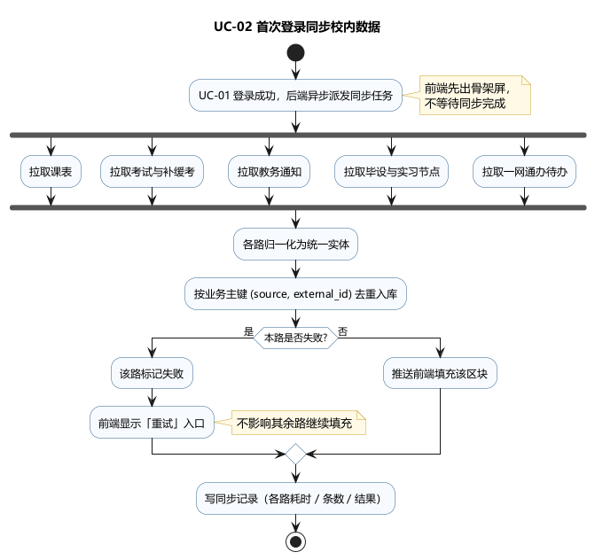
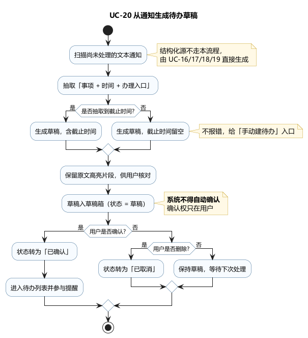
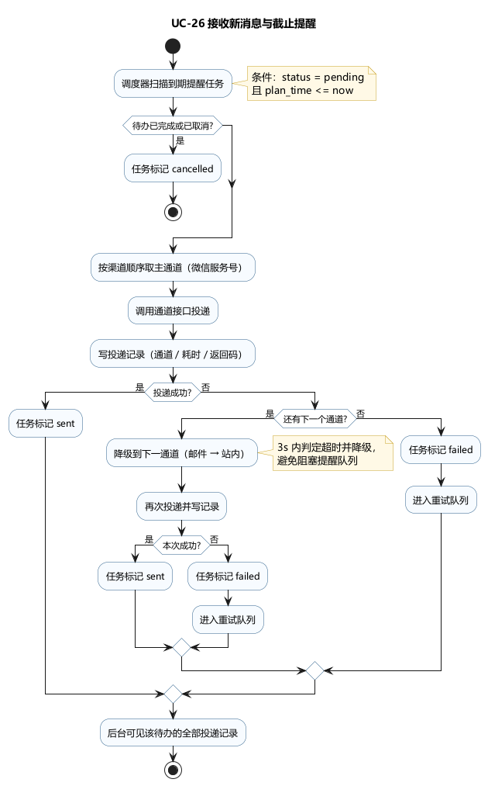

# 软件需求规格说明（SRS）v1.0

> 对应单元：2 需求调研与规约｜检查点：第 3 次课（第 11 周）评审定稿 → Release v1.0
> 负责人：需求分析师｜状态：草稿，待评审签字
> 依据：[选题文稿 v3](../00-立项/选题文稿.md)、[可行性探测报告](../00-立项/可行性探测报告.md)

## 0. 文档信息

| 项 | 内容 |
|---|---|
| 文档版本 | v1.0（草稿） |
| 基线日期 | 待填 |
| 编写 | 待填 |
| 评审 | 待填 |
| 批准（基线） | 待填 |
| 关联文档 | [用例清单](用例清单.md)、[需求追溯矩阵](需求追溯矩阵.md)、[变更记录](变更记录.md) |

---

## 1. 引言

### 1.1 编写目的

定义「面向大学生的校园待办中心」的功能与非功能需求，作为设计、编码、测试与验收的基线。
本文档的每一条需求都必须**可测试**、**可追溯到用例**、**锚定真实数据来源**。

### 1.2 项目范围

**本期实现**：校内结构化数据接入 → 统一通知流 → 待办生成与状态管理 → 多渠道提醒 → 资料收藏与后台管理。

**本期不做**：

| 不做项 | 理由 |
|---|---|
| 成绩、选课、作业提交等学习管理 | 与待办中心边界重叠；学校无作业接口（237 个接口中命中 0） |
| 微信群 / QQ 群自动接入 | 无官方开放接口，仅做手动导入 |
| 节假日顺延提醒 | 校历接口恒返回 `A07500`，无可信数据 |
| 图书"到期"提醒 | 借阅接口无应还日，只有催还日，降级为提示 |
| 支付类集成 | 需企业资质与商户号 |
| 学院源全覆盖 | 只做本科生院等 1–2 个官网栏目 |

### 1.3 术语与缩写

| 术语 | 定义 |
|---|---|
| FR | 功能需求（Functional Requirement），编号 FR-1 ~ FR-22 |
| NFR | 非功能需求，编号 NFR-1 ~ NFR-7 |
| UC | 用例（Use Case），编号 UC-01 ~ UC-34 |
| DC 接口 | 批量接口，用于首次建底（如 `student_timetable`） |
| RT 接口 | 实时接口，用于增量校准（如 `absent_examinfo`） |
| 结构化待办 | 由结构化数据直接生成的待办，`auto_confirmed=true`，无需人工确认 |
| 文本待办草稿 | 从通知正文抽取生成的草稿，须用户确认后才进入待办列表 |
| 业务主键 | `source + external_id`，用于幂等去重与改期判定 |
| 改期 | 同一业务主键的内容哈希发生变化 |

### 1.4 参考资料

| 文档 | 说明 |
|---|---|
| [选题文稿 v3](../00-立项/选题文稿.md) | 定位、数据来源、22 项 FR、38 个用例 |
| [可行性探测报告](../00-立项/可行性探测报告.md) | 17 类数据源实测、5 个硬缺口、接口语义 |
| [用例清单](用例清单.md) | 38 个用例的参与者、增量、FR 映射 |
| 《软件工程课程设计要求（版本2）》 | 硬指标与交付物清单 |

---

## 2. 总体描述

### 2.1 产品前景

学生要跟进的校园事项分散在课表、考试安排、教务通知、毕设节点、一网通办、官网公告、课程群等多个渠道，
且每类渠道的"时间"含义不同（课表是周期性、考试是单次、通知是文本里的模糊表述）。
本系统把这些渠道统一为一个"待办中心"，**用结构化数据直接给时间，用文本抽取兜底**，并通过多渠道提醒降低错过率。

### 2.2 用户角色与特征

| 角色 | 类型 | 主要职责 | 数据权限边界 | 技术水平 |
|---|---|---|---|---|
| 学生 `student` | 主要 | 查看通知与待办、管理提醒与收藏 | 仅本人数据 | 熟练使用手机与网页 |
| 班委 / 组织干事 `publisher` | 主要 | 发布班级通知、查看阅读情况 | 仅本班范围 | 一般 |
| 系统管理员 `admin` | 主要 | 维护源与同步任务、管理用户角色 | 全局配置，不读待办正文 | 较高 |
| 助教 / 教师（可选，v0.3） | 次要 | 发布课程通知、查看完成率 | 仅本课程聚合统计 | 一般 |

权限模型：**RBAC + 资源归属校验**。越权统一返回 403，且不泄露资源是否存在。

### 2.3 运行环境

| 项 | 要求 |
|---|---|
| 客户端 | 移动端浏览器（微信内置浏览器优先）、桌面浏览器（Chrome / Edge 最近两个大版本） |
| 服务端 | Linux，Python 3.11+ |
| 数据库 | 开发 SQLite / 部署 PostgreSQL |
| 调度 | 进程内定时任务（同步、提醒、补扫） |
| 网络 | 需可访问学校开放平台、GitHub、邮件服务、微信服务号接口 |

### 2.4 设计与实现约束

| 编号 | 约束 |
|---|---|
| C-1 | 不新建密码体系，身份完全依赖学校统一身份认证 |
| C-2 | 校内数据接口的 `userId` 只能取当前登录用户，**不接受前端传入** |
| C-3 | 仅客户端模式接口由后端以应用身份调用，须代码断言 + 审计日志（见 3.3） |
| C-4 | 非当前登录用户的校内数据不得落库（数据最小化） |
| C-5 | 密钥（开放平台 secret、SendKey、SMTP 密码）不得入库、不得进提示词 |
| C-6 | 全部工程活动在 GitHub 留痕，`main` 分支禁止直推 |
| C-7 | 每个增量打 Release 并绑定 Milestone |

### 2.5 假设与依赖

| 编号 | 假设 / 依赖 | 若不成立的影响 |
|---|---|---|
| A-1 | 开放平台应用登记与 scope 审批通过 | v0.1 降级为"手动导入 + 官网 + GitHub"三条零依赖路径，校内接口以 mock 驱动开发 |
| A-2 | 学校 OAuth 回调地址备案完成 | 无法登录，整个校内链路不可用 |
| A-3 | 学期接口 `teaching_info/semester` 可用（匿名） | 周次换算失效，需改用人工输入学期 |
| A-4 | Server酱 / PushPlus 服务可用 | 提醒降级为邮件 + 站内 |
| A-5 | GitHub 公开 API 配额（60 次/小时/IP） | 多用户挤占时仓库更新延迟，需配 Token |

---

## 3. 系统接口

### 3.1 校内数据接口（17 类）

> 字段取自接口文档返回参数表。**完整清单与实测结果见 [可行性探测报告](../00-立项/可行性探测报告.md)。**

| 数据 | 接口 | 授权模式 | 关键字段 | 支撑 FR |
|---|---|---|---|---|
| 课表（批量） | `GET /v2/dc/teaching_info/student_timetable` | 客户端 / 授权码 | weekday、startUnit、endUnit、week、classroomName、courseName、teacherName、delInd | FR-3 |
| 实时课表 | `GET /v1/rt/onetongji/student_timetable` | 客户端 / 授权码 | courseCode、classTime、credits | FR-3 |
| 期末考试 | `GET /v1/rt/teaching_info/absent_examinfo` | 客户端 | examDate、examStartTime、examEndTime、roomName、courseName、examStatus | FR-4 |
| 补缓考 | `GET /v1/rt/teaching_info/deferred_examinfo` | 客户端 | 同上，examType=2 | FR-4 |
| 教务通知 | `GET /v1/rt/onetongji/msg_list`、`msg_detail` | 客户端 | title、content(HTML)、publishTime、faceUserName、commonAttachmentList | FR-6 |
| 学年学期 | `GET /v1/rt/teaching_info/semester` | **匿名** | semesterName、beginDay、endDay、examWeekStart、examWeekEnd | FR-3 |
| 毕设选题 | `GET /v1/dc/teaching_info_thesis_topic` | 客户端 / 授权码 | topicTime、topicAddress、paperName | FR-5 |
| 中期考核 | `GET /v1/dc/teaching_info_midterm_assessment` | 客户端 / 授权码 | assessTime、assessAddress、approvalStatusName | FR-5 |
| 预答辩 | `GET /v1/dc/teaching_info_pre_defense` | 客户端 / 授权码 | defenseDate、defenseAddr、teacherName | FR-5 |
| 实习课程 | `GET /v1/dc/teaching_info_internship_course_scheduling` | 客户端 / 授权码 | courseDateStart、courseDateEnd、practiceDays | FR-5 |
| 一网通办待办 | `GET /v1/infra/task_center/task_list` | 客户端 / 授权码 | taskId、nodeName、taskStatus、formUrl | FR-13 |
| 个人日程 | `POST /v1/infra/calendar/person/create`（update/delete/list） | 客户端 / 授权码 | eventRepeatType、remindTimes、linkUrl | FR-18 |
| 图书借阅 | `GET /v2/dc/lib_lend_info_all` | 客户端 / 授权码 | title、lendDate、asbackDate、retDate | FR-13（仅提示） |
| 截图识别（可选） | `POST /v1/ai/tools/file2md/task` | 客户端 | file_url → Markdown | FR-9（v0.3） |
| 官网栏目 | 本科生院 `/30359/list.htm` 等 HTML | 无（公开） | 列表条目、`div.wp_articlecontent` 正文 | FR-7 |
| GitHub 仓库 | `GET /api.github.com/repos/{owner}/{repo}/commits` | 公开 REST + ETag | sha、commit.message、commit.author.date | FR-8 |
| 提醒投递 | Server酱 / PushPlus HTTPS | 用户 SendKey / Token | title、desp、token | FR-18 |

**三条必须写进设计文档的事实**

1. **两个匿名接口只有一个可用**：`semester` 返回 66 个学期可用；`onetongji/calendar`（校历）恒返回 `A07500`，不可依赖 → 不做节假日顺延。
2. **教务通知接口无参数**（`parameters` 为 `null`），返回全校通知，需按 `faceUserName` 过滤受众；其 `startTime`/`endTime` 是展示有效期，**不是办理截止时间**。
3. **学校没有作业接口**（237 个接口命中 0），作业由学生自助登记（FR-16）或从正文抽取，系统不承诺"自动同步作业"。

### 3.2 外部集成点（7 个）

| 集成点 | 用途 | 选型 | 增量 |
|---|---|---|---|
| 学校统一身份认证 | 登录与身份（学工号） | OAuth2 授权码 + OIDC（`kc_idp_hint=tjiam`） | v0.1 |
| 开放平台数据接口 | 课表、考试、通知、毕设、待办 | REST + Bearer Token，缓存 7200s，401 重取 | v0.1 |
| GitHub REST API | 仓库提交与发布 | 公开接口 + ETag + Token | v0.1 |
| 官网栏目 | 公告与竞赛信息 | HTML 适配器（无 RSS） | v0.1 |
| 微信服务号 | 提醒主通道 | Server酱 / PushPlus | v0.2 |
| 邮件 SMTP | 提醒兜底 | 标准 SMTP，全局单发信账号 | v0.2 |
| 学校日程服务 | 待办写入校园号日程（不承诺提醒） | `infra/calendar/person/*` | v0.3（可选） |

### 3.3 接口调用约束（合规）

| 授权模式 | 调用身份 | `userId` 来源 | 附加要求 |
|---|---|---|---|
| 授权码模式 | 当前登录用户 token | 从 token 解析 | 不接受前端传入 |
| 客户端模式 | 后端应用身份 | **必须等于当前登录用户** | 代码层断言 + 写审计日志 + 设计文档显式登记例外 |
| 匿名 | 无需身份 | 不涉及 | 仅学期接口 |

---

## 4. 功能需求

### 4.1 功能需求清单（FR-1 ~ FR-22）

> 验收标准写成可被测试用例直接引用的形式。

| 编号 | 需求名称 | 描述 | 验收标准 | 关联用例 |
|---|---|---|---|---|
| FR-1 | 统一身份认证登录 | 学校 OAuth2 授权码模式，解析 `userid`（学工号）为唯一身份 | 新用户 ≤3 次点击完成；同一学工号不产生第二个账号 | UC-01 |
| FR-2 | 首次登录同步 | 登录后异步触发五路同步，前端骨架屏，各路完成即填充 | 首屏 10s 内可用；单路失败不影响其他路 | UC-02 |
| FR-3 | 课表同步与课程档案 | 按 `(学号,学年,学期)` 拉课表，展开为"课程+节次"；`delInd='D'` 标退课 | 退课后周视图消失、历史保留；同节次不重复入库 | UC-03、UC-04 |
| FR-4 | 考试与补缓考同步 | 先取学期编号，再取考试与补缓考；`examStatus=1` 时考场为空 | 每场考试一条待办，含日期/起止/考场/课程/教师 | UC-05、UC-06、UC-16 |
| FR-5 | 毕设与实习节点同步 | 拉选题、中期、预答辩三类节点与实习起止日期 | 三类节点各一条待办；时间或地点缺失时字段留空 | UC-36、UC-18 |
| FR-6 | 教务通知同步 | 拉全校通知，按 `faceUserName` 记受众；HTML 清洗入库，附件单独登记 | 重复同步不重复入库；正文可读、附件可下载 | UC-07 |
| FR-7 | 官网栏目适配器 | 每源一份配置（列表 URL、条目选择器、正文选择器、日期格式） | 新增同类栏目只改配置；单源连续失败 3 次降级手动导入 | UC-11、UC-13、UC-15 |
| FR-8 | GitHub 仓库订阅 | 拉 commits 与 releases，ETag 条件请求 | 304 时不产生新通知、不消耗配额 | UC-12、UC-13、UC-15 |
| FR-9 | 手动导入 | 粘贴文本、粘贴链接、上传截图三种入口 | 导入后立即可见，可归类、可生成待办 | UC-14 |
| FR-10 | 统一通知流 | 多源合并为一条时间线，按来源/类型/课程/未读筛选，游标分页 | 1000 条下首屏 P95 ≤1.5s；筛选组合结果正确 | UC-08、UC-09、UC-10 |
| FR-11 | 归类与关联 | 按课程名/课程号/教师名归到课程，按关键词归类型 | 含课程名的通知命中率 ≥90%（50 条样本人工核对） | UC-35 |
| FR-12 | 改期与撤回检测 | 业务主键内容哈希变化时生成核对提示，不覆盖用户编辑 | 原待办保留用户修改，另生成提示；撤回标灰不提醒 | UC-27 |
| FR-13 | 结构化待办（自动确认） | 考试/补缓考/上课/毕设/实习/一网通办/图书催还七类直接生成，`auto_confirmed=true` | 待办条数 = 考试数+节点数+节次数（去重后），无重复无遗漏 | UC-16、UC-17、UC-18、UC-19 |
| FR-14 | 文本待办草稿 | 从正文抽"事项+时间+入口"，生成草稿并保留原文高亮 | 草稿可一键跳回原文；抽取失败给"手动建待办"入口 | UC-20、UC-21 |
| FR-15 | 待办状态机 | 草稿→已确认→进行中→已完成；可转已过期/已取消 | 非法迁移返回 409；每次迁移写状态日志 | UC-21、UC-22、UC-23 |
| FR-16 | 作业自助登记 | 按"课程+标题+截止时间+提交方式"登记，可附链接/截图/备注 | 登记后立即可见；逾期标红；重复登记提示合并 | UC-34 |
| FR-17 | 提醒规则 | 每类待办设默认提前量与渠道顺序，单条可覆盖 | 改规则后新待办按新规则，历史不受影响 | UC-24 |
| FR-18 | 提醒投递与渠道绑定 | 扫码绑定微信服务号，按主→兜底投递，每次写投递记录 | 绑定后 1 分钟内收到测试消息；主通道失败 3s 内落兜底 | UC-25、UC-26 |
| FR-19 | 收藏与检索 | 收藏文本/链接/截图，加备注标签关联课程；全文检索 | 搜索 200ms 内返回；标签与课程可组合筛选 | UC-28、UC-29、UC-30 |
| FR-20 | 班级通知发布与阅读统计 | 班委向本班发布通知，记阅读回执 | 仅本班可见；阅读率 = 已读人数/班级人数 | UC-31 |
| FR-21 | 源与同步任务监控 | 管理员看每源最近同步、成功失败次数、健康度；可手动触发/暂停 | 连续失败 3 次标红并降级；手动触发有审计记录 | UC-32 |
| FR-22 | 用户、角色与审计 | RBAC + 归属校验；管理操作写审计（仅元数据） | 越权统一 403 且不泄露存在性；审计可按操作人检索 | UC-33 |

### 4.2 用例清单

> 完整 40 个用例（36 功能 + 4 非功能）见 [用例清单](用例清单.md)。此处仅列与 FR 的对应关系。

用例总数 **40**，其中功能 36、非功能 4，满足"不少于 20 个且含至少 2 个非功能用例"。

**覆盖率：FR 22/22 全部有用例对应**（v3.1 已补齐 UC-35、UC-36）。

### 4.3 用例详细描述

#### 4.3.1 描述模板

> 每个用例一张表。至少 3 个细化用例须配活动图（见 `models/sequence/`）。

| 项 | 内容 |
|---|---|
| 用例编号 | UC-xx |
| 用例名称 | 动宾短语 |
| 主参与者 | 主动发起者 |
| 次参与者 | 被调用的外部系统，无则填 — |
| 描述对象 | 一句话说明这个用例作用于什么 |
| 说明 | 补充背景与边界 |
| 频度 | 每次登录 / 每日一次 / 按需 |
| 优先级 | 高 / 中 / 低 |
| 前置条件 | 用例开始前必须成立的条件 |
| 后置条件 | 用例成功后系统应处于的状态 |
| 被包含 / 被扩展的用例 | include / extend 关系，无则填无 |
| **基本操作流程** | 编号步骤，主成功场景 |
| **可选操作流程** | A1/A2… 扩展场景（异常与分支） |
| **验收标准** | Given / When / Then，可被测试用例直接引用 |
| 关联需求 | FR-x |

#### 4.3.2 UC-01 通过学校统一身份认证登录（已细化）

| 项 | 内容 |
|---|---|
| 用例编号 | UC-01 |
| 用例名称 | 通过学校统一身份认证登录 |
| 主参与者 | 学生 |
| 次参与者 | 学校统一身份认证（OAuth2 授权码 + OIDC） |
| 描述对象 | 学生使用学校账号登录本系统 |
| 说明 | 走学校 OAuth2 授权码模式（`kc_idp_hint=tjiam`），回调换 token，解析 `userid`（学工号）作为唯一身份；**不新建密码体系** |
| 频度 | 每个会话一次 |
| 优先级 | 高 |
| 前置条件 | 学生持有有效学校账号；本系统已在开放平台登记回调地址并备案 |
| 后置条件 | 建立会话；首次登录创建本地账号并授予 `student` 角色；触发 UC-02 |
| 被包含 / 被扩展 | 无 |
| 基本操作流程 | 1. 学生点击「学校统一身份认证登录」 2. 系统 302 跳转学校授权页（`kc_idp_hint=tjiam`） 3. 学生输入学校账号密码并授权 4. 学校回调携带 `code` 5. 后端用 `code` 换 `access_token` 6. 调用用户信息接口解析 `userid` 7. 按学工号查本地账号，不存在则创建并授 `student` 8. 建立会话，跳转首页并异步触发首次同步（UC-02） |
| 可选操作流程 | A1 学生在授权页拒绝授权：提示"未授权，无法登录"，返回登录页，不建立会话 A2 `code` 换 token 失败：记录错误日志，提示稍后重试，响应中不出现密钥与错误细节 A3 回调地址与备案不一致：拒绝处理并写安全告警 A4 同一学工号重复登录：复用原账号，不产生第二个账号 |
| 验收标准 | Given 新学工号首次登录 When 完成授权 Then 创建唯一账号并进入首页，全程 ≤3 次点击 Given 已注册学工号 When 再次登录 Then 不新增账号，直接进入 Given 学生拒绝授权 When 流程结束 Then 无会话且提示未授权 Given 同一学工号并发登录两次 When 均完成授权 Then 只存在一个账号 |
| 关联需求 | FR-1 |

#### 4.3.3 UC-16 自动生成考试待办（已细化）

| 项 | 内容 |
|---|---|
| 用例编号 | UC-16 |
| 用例名称 | 自动生成考试待办 |
| 主参与者 | 定时调度器 |
| 次参与者 | 同济开放平台数据接口 |
| 描述对象 | 从考试与补缓考数据生成已确认待办 |
| 说明 | 先取当前学期编号，再拉期末考试与补缓考，按"考场+课程+起止时间"生成待办，`auto_confirmed=true`，无需用户确认 |
| 频度 | 每日一次（可配置） |
| 优先级 | 高 |
| 前置条件 | 用户已完成 UC-01 登录且持有有效 token；学期编号可取 |
| 后置条件 | 每场考试生成一条已确认待办；`examStatus=1`（未排考场）时 `roomName` 留空 |
| 被包含 / 被扩展 | 无 |
| 基本操作流程 | 1. 调度器触发 2. 调 `teaching_info/semester` 取当前学期编号 3. 调 `absent_examinfo` 拉期末考试 4. 调 `deferred_examinfo` 拉补缓考 5. 按业务主键 `(source, external_id)` 去重 6. 逐条生成待办：日期、起止时间、考场、课程、任课教师，`auto_confirmed=true` 7. 写同步记录（时间、条数、结果） |
| 可选操作流程 | A1 学期接口失败：本轮跳过并标记失败，下轮重试，不阻塞其他同步路 A2 考场未排（`examStatus=1`）：`roomName` 留空，待办仍生成，UI 显示"考场待定" A3 补缓考无数据：不生成待办，不视为错误 A4 token 返回 401：刷新 token 后重试一次，仍失败则降级并写告警 A5 同一考试重复同步：命中业务主键，更新而非新增 |
| 验收标准 | Given 当前学期有 3 场考试 When 同步完成 Then 生成 3 条待办，字段完整且 `auto_confirmed=true` Given 某场考试考场未排 When 同步 Then 待办存在且考场为空，不报错 Given 已完成一次同步 When 立即再同步一次 Then 待办总数不变 Given 考试时间被修改 When 下次同步 Then 原待办更新并生成核对提示（UC-27） |
| 关联需求 | FR-4、FR-13 |

#### 4.3.4 UC-02 首次登录同步校内数据（已细化）

| 项 | 内容 |
|---|---|
| 用例编号 | UC-02 |
| 用例名称 | 首次登录同步校内数据 |
| 主参与者 | 定时调度器（由 UC-01 登录成功后经 `<<include>>` 触发） |
| 次参与者 | 同济开放平台数据接口 |
| 描述对象 | 新用户首次进入系统时，五路校内数据并行拉取并填充首屏 |
| 说明 | 同步**异步**执行：前端先出骨架屏，各路完成即填充，不阻塞首屏渲染。单路失败不影响其余路 |
| 频度 | 每个账号首次登录一次；之后由 UC-04/05/07/36 周期增量同步 |
| 优先级 | 高 |
| 前置条件 | UC-01 已完成，持有有效 `access_token` 与学工号；学期编号可获取 |
| 后置条件 | 课表、考试、教务通知、毕设节点、一网通办待办五类数据入库；同步记录写入 |
| 被包含 / 被扩展 | 被 UC-01 包含（`<<include>>`） |
| 基本操作流程 | 1. UC-01 登录成功，后端异步派发同步任务 2. 并行发起五路请求：课表、考试与补缓考、教务通知、毕设与实习节点、一网通办待办 3. 每路响应归一化为统一实体（通知 / 节点 / 待办） 4. 按业务主键 `(source, external_id)` 去重入库 5. 每路完成即推送前端填充对应区块 6. 五路全部结束，写同步记录（各路耗时、条数、结果） |
| 可选操作流程 | A1 某一路失败：该路标记失败并在前端显示"重试"，其余路照常填充 A2 学期接口失败：课表与考试无法换算周次，标记为待重试，不生成错误待办 A3 `access_token` 过期：刷新一次后重试；仍失败则整体降级为手动导入 A4 用户在同步完成前关闭页面：同步在服务端继续，下次进入直接读库 A5 同一账号重复触发同步：命中业务主键，更新而非新增 |
| 验收标准 | Given 新用户首次登录 When 进入首页 Then 10s 内可见课表、考试、通知三类数据，各路独立填充 Given 某一路接口失败 When 同步结束 Then 其余路数据正常显示，失败路出现"重试"入口 Given 已完成首次同步 When 再次触发同步 Then 数据条数不变（幂等） Given 同步进行中 When 用户关闭页面 Then 服务端任务不中断 |
| 关联需求 | FR-2 |

#### 4.3.5 UC-26 接收新消息与截止提醒（已细化）

| 项 | 内容 |
|---|---|
| 用例编号 | UC-26 |
| 用例名称 | 接收新消息与截止提醒 |
| 主参与者 | 学生 |
| 次参与者 | 微信服务号（Server酱 / PushPlus）、邮件 SMTP、学校日程服务（可选） |
| 描述对象 | 学生在截止前按设定提前量收到提醒 |
| 说明 | 服务端按"主通道 → 兜底"顺序投递，每次尝试写投递记录；**验收只考核服务端发出时间，到达时间由服务商决定** |
| 频度 | 每条待办按提醒规则触发（默认每类 1–2 次） |
| 优先级 | 高 |
| 前置条件 | 学生已绑定至少一个提醒渠道；存在"已确认"待办且设置了提醒规则；提醒任务已生成 |
| 后置条件 | 提醒已送达至少一个渠道；投递记录落库（通道、计划时间、实际发出时间、结果） |
| 被包含 / 被扩展 | 被 UC-24（提醒规则）包含 |
| 基本操作流程 | 1. 调度器扫描到期的提醒任务（`status=pending` 且 `plan_time<=now`） 2. 按用户渠道顺序取主通道 3. 调用服务商 HTTPS 接口投递（标题、摘要、待办链接） 4. 记录本次尝试：通道、耗时、返回码 5. 成功则任务标记 `sent`；失败按序降级到下一通道 6. 所有通道均失败则标记 `failed` 并进入重试队列 |
| 可选操作流程 | A1 主通道额度用尽或返回限流：直接降级到邮件，不重试主通道 A2 服务商请求超时：3s 内判定失败并降级，避免阻塞队列 A3 用户未绑定任何渠道：以站内信兜底，并在前端提示"绑定微信可及时收到" A4 同一任务被并发消费两次：乐观锁（`UPDATE ... WHERE status='pending'`）保证只发一次 A5 服务重启：启动时补扫 `pending` 且已过期的任务并补发 A6 待办已被标记完成：跳过本次提醒，任务标记 `cancelled` |
| 验收标准 | Given 已绑定微信服务号 When 到达提醒提前量 Then 服务端在计划时间 ±60s 内发出投递请求，投递记录可见 Given 主通道返回失败 When 投递 Then 3s 内降级到邮件通道，记录中可见两次尝试 Given 同一提醒任务被两个消费者同时取到 When 投递 Then 只实际发送一次 Given 服务在提醒到期前重启 When 服务恢复 Then 过期未发任务被补发 |
| 关联需求 | FR-18、NFR-3 |

#### 4.3.6 其余用例

> 已细化 4 个：UC-01、UC-02、UC-16、UC-26（满足"至少 3 个细化用例"）。
> 其余 36 个按 4.3.1 模板补齐，可分批提交。
>
> **活动图**：至少 3 个细化用例须配活动图，已完成 UC-02、UC-20、UC-26 三张，
> 源文件见 `models/sequence/`，命名 `act-<uc编号>-<简述>.puml`。

**UC-02 首次登录同步校内数据**

**UC-20 从通知生成待办草稿**

**UC-26 接收新消息与截止提醒**

---

## 5. 非功能需求

| 编号 | 类别 | 需求描述 | 验收方式 | 关联用例 |
|---|---|---|---|---|
| NFR-1 | 性能 | 通知与待办合计 1000 条时，首屏 P95 ≤1.5s | 造数脚本 + 计时，连续 20 次取 P95 | NFR-UC-04 |
| NFR-2 | 可靠性 / 幂等 | 同一数据重复同步 N 次（N≥5），仅入库 1 条 | 重复投喂同一批响应，断言记录数与主键唯一 | NFR-UC-01 |
| NFR-3 | 及时性 | 服务端在计划时间 ±60s 内发出投递请求（到达时间由服务商决定，不计入验收） | 提前量缩到 2 分钟，查投递记录中的发出时间 | NFR-UC-03 |
| NFR-4 | 安全 | 越权访问他人待办返回 403 且不泄露内容 | 双账号交叉请求，比对响应体与状态码 | NFR-UC-02 |
| NFR-5 | 可用性 | 单一数据源失败时降级为手动导入，主流程不中断 | 停用源 + 断网演示，其余功能仍可用 | — |
| NFR-6 | 时效性 | 登录后首屏 10s 内可用（异步同步 + 骨架屏） | 冷启动计时，记录各路同步完成时间 | NFR-UC-04 |
| NFR-7 | 合规 / 最小化 | 非当前登录用户的校内数据不落库；日志与审计不含待办正文 | 代码审查 + 数据库抽查，确认无他人 `userId` 明细 | — |

---

## 6. 数据需求

### 6.1 核心数据实体

> 完整 29 个分析类见 [选题文稿 v3](../00-立项/选题文稿.md) 第十二节，类图见 [../03-需求分析模型/类图与CRC.md](../03-需求分析模型/类图与CRC.md)。

| 实体 | 关键字段 | 来源 |
|---|---|---|
| 用户 | 学工号、姓名、角色、班级 | UC-01 |
| 通知记录 | 标题、正文、来源、业务主键、内容哈希、发布时间 | UC-02/07/15 |
| 订阅源 | 类型、地址、配置、健康状态 | UC-11/12/13 |
| 待办 | 标题、截止时间、地点、状态、`auto_confirmed`、来源 | UC-16~21 |
| 提醒规则 / 投递记录 | 提前量、渠道、计划时间、实际发出时间、结果 | UC-24/26 |
| 作业登记 | 课程、标题、截止时间、提交方式 | UC-34 |
| 日程映射 | 待办 ID ↔ 学校日程 event_id | UC-25 |

### 6.2 数据最小化与合规

- 只落当前登录用户自己的校内数据，**不缓存他人数据**（NFR-7）
- 审计日志只记元数据（操作人、对象 ID、动作、时间），不记待办正文
- 密钥、SendKey、SMTP 密码只存环境变量，不入库、不进提示词
- 用户可删除自己的收藏与作业登记；注销时级联清理个人数据

---

## 7. 需求追溯

> 矩阵 v0（需求 ↔ 用例）随本文件发布，v1 在分析建模阶段补充"↔ 分析类"与"↔ 测试用例"。
> 维护位置：[需求追溯矩阵](需求追溯矩阵.md)。

**当前覆盖情况**

| 指标 | 目标 | 当前 |
|---|---|---|
| FR 有用例覆盖 | 22/22 | 22/22 ✅ |
| 用例有 FR 来源 | 38/38 | 38/38 |
| 用例有非功能需求对应 | 4/4 | 4/4 |

---

## 8. 变更记录

> 变更必须走 Issue + PR，不允许口头变更。登记表见 [变更记录](变更记录.md)。

| 编号 | 日期 | 变更内容 | 影响 | 批准 |
|---|---|---|---|---|
| CR-001 | 2026-11-20 | 选题 v2 → v3：主源改校内结构化接口、登录改学校统一身份认证、用例 26→34 | 全文重写 | 待填 |
| CR-002 | 2026-11-20 | 新增 FR-16 作业自助登记（UC-34） | 新增 1 项 FR、1 个用例 | 待填 |

---

## 附录 A 立项硬指标自检

| 硬指标 | 要求 | 本项目 | 状态 |
|---|---|---|---|
| 可交付增量 | ≥3 | 3（v0.1/v0.2/v0.3） | ✅ |
| 用例 | ≥20，含 ≥2 非功能 | 38（34 功能 + 4 非功能） | ✅ |
| 分析类 | ≥15 | 29 | ✅ |
| 技术风险点 | ≥1 | 11（R1、R3 重点管理） | ✅ |
| 用户角色 | ≥3 | 4（教师为可选） | ✅ |
| 外部集成点 | ≥1 | 7 | ✅ |
| 需求可测试 | 全部有验收标准 | 22/22 FR 有验收口径 | ✅ |
| 文档可追溯 | 需求↔用例↔设计↔测试 | 需求↔用例 v0 已建，其余待补 | ⏳ |
