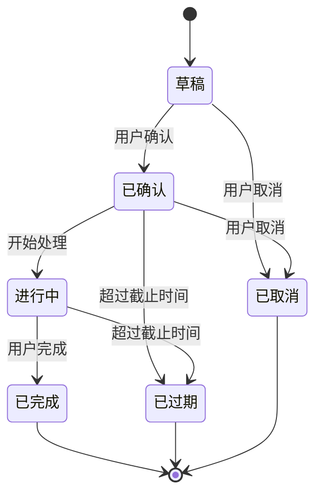
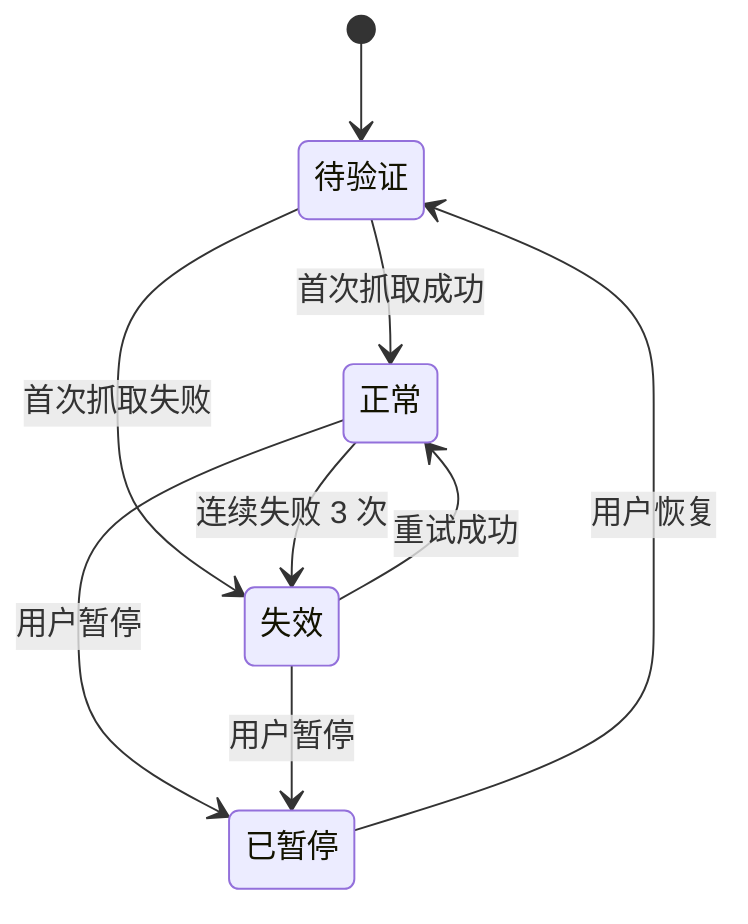
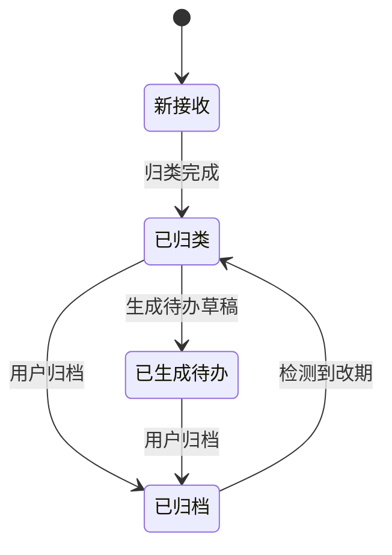

# 行为模型

> ⚠️ **选题已于 2026-11-20 升级到 v3**：主源改为校内结构化接口，登录改为学校统一身份认证，用例编号由 UC-01~26 调整为 UC-01~33。本文件仍按 v2 编写，编号与范围待按 v3 重写——进度与编号映射见 [变更说明-选题v3](../00-立项/变更说明-选题v3.md)。

> 对应单元：3 需求建模｜检查点：第 4 次课（草稿）、第 5 次课（定稿）
> 负责人：架构 / 设计工程师｜状态：待填写

## 1. 状态图（≥2 个关键类）

### 1.1 待办事项 TodoItem

> 约束：只有用户操作能触发「草稿 → 已确认」，系统不得自动确认。

### 1.2 订阅源 Source

### 1.3 通知记录 Notice

## 2. 顺序图（建议 ≥2 个）

| 编号 | 场景 | 源文件 |
|---|---|---|
| SD-01 | 定时抓取 → 去重 → 入库 | `models/sequence/sd01-fetch.puml` |
| SD-02 | 提醒调度 → 发送 → 回写状态 | `models/sequence/sd02-remind.puml` |

> 顺序图重点体现：幂等（NFR-2）、降级（NFR-5）、越权拦截（NFR-4）。

## 3. 与需求的一致性自查

| 检查项 | 结论 |
|---|---|
| 每个状态都能在需求中找到触发条件 | |
| 每个状态迁移都有对应测试用例 | |
| 无孤立状态（进得去出不来） | |
