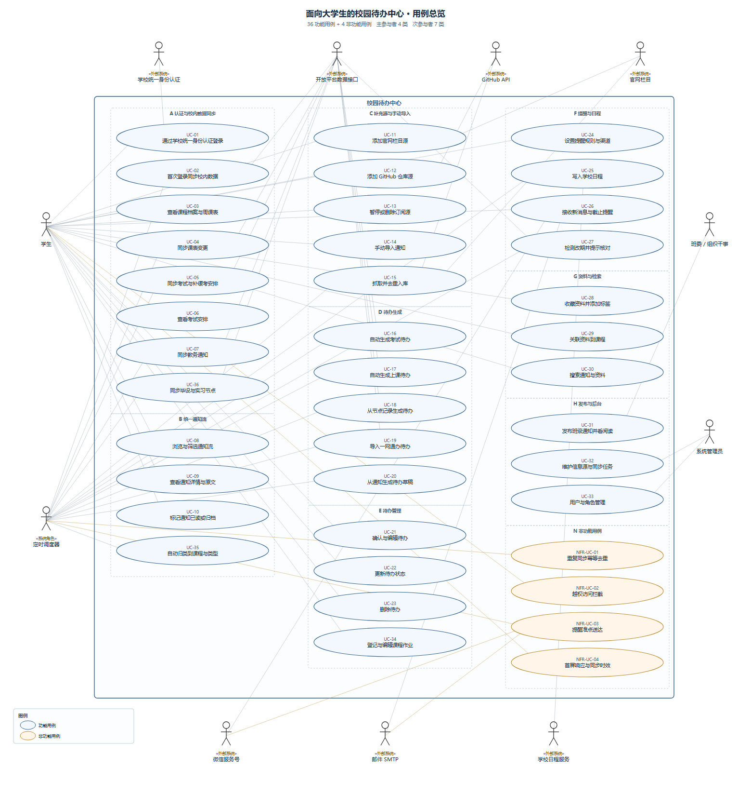
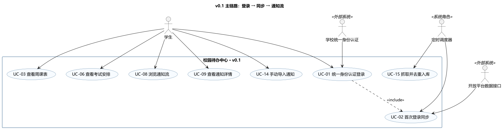
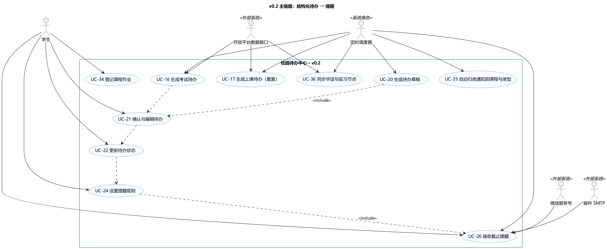
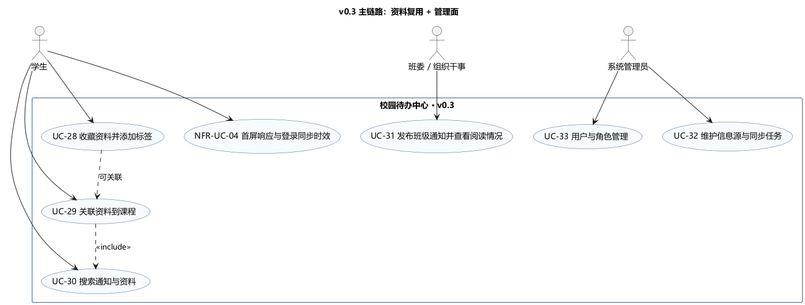

# 用例模型

> 对应单元：3 需求建模｜检查点：第 4 次课（草稿）、第 5 次课（定稿）
> 负责人：需求分析师｜状态：草稿，待评审
> 数据源：[用例清单](../02-需求规约/用例清单.md)（38 个用例）、[SRS v1.0](../02-需求规约/SRS-v1.0.md)

## 1. 参与者

### 1.1 主参与者

| 参与者 | 类型 | 说明 |
|---|---|---|
| 学生 | 人 | 主要用户，查看通知与待办、管理提醒与收藏 |
| 班委 / 学生组织干事 | 人 | 发布班级通知，查看阅读情况 |
| 系统管理员 | 人 | 维护信息源与同步任务、管理用户角色 |
| 定时调度器 | 系统角色 | 按周期触发同步与提醒，不是人 |

> 助教 / 教师为 v0.3 可选角色，本期**不建模用例**，其能力并入 UC-31。若启用需新增用例并更新本节。

### 1.2 次参与者

| 参与者 | 被谁调用 | 用在哪里 |
|---|---|---|
| 学校统一身份认证 | 系统 | UC-01 登录（OAuth2 + OIDC，`kc_idp_hint=tjiam`） |
| 开放平台数据接口 | 系统 | UC-02/04/05/07/16/17/18/19/27 |
| 学校日程服务 | 系统 | UC-25 写入日程 |
| 微信服务号 | 系统 | UC-26 提醒主通道 |
| 邮件 SMTP | 系统 | UC-26 提醒兜底 |
| GitHub REST API | 系统 | UC-12/15 |
| 官网栏目（HTML） | 系统 | UC-11/15 |

## 2. 模块总览

> 38 个用例按 8 个功能模块 + 1 个非功能模块组织。**这张表替代"单张总览图"**（原因见第 5 节）。

| 模块 | 用例 | 数量 |
|---|---|---|
| A 认证与校内数据同步 | UC-01 ~ UC-07 | 7 |
| B 统一通知流 | UC-08 ~ UC-10 | 3 |
| C 补充源与手动导入 | UC-11 ~ UC-15 | 5 |
| D 待办生成 | UC-16 ~ UC-20 | 5 |
| E 待办管理 | UC-21 ~ UC-23、UC-34 | 4 |
| F 提醒与日程 | UC-24 ~ UC-27 | 4 |
| G 资料与检索 | UC-28 ~ UC-30 | 3 |
| H 发布与后台 | UC-31 ~ UC-33 | 3 |
| N 非功能用例 | NFR-UC-01 ~ 04 | 4 |
| **合计** | | **38** |

## 3. 分增量用例图

> 每张图只画一个增量的主链路（7–8 个用例），保证在 8 分钟讲解里能讲清。

| 图 | 覆盖 | 源文件 | 渲染尺寸 |
|---|---|---|---|
| **总览图** | 全部 40 个用例 + 11 类参与者 | `models/usecase/usecase-overview.svg` | 1560×1678 |
| v0.1 主链路 | 登录 → 同步 → 通知流（8 个用例） | `models/usecase/usecase-v01.puml` | 1710×442 |
| v0.2 主链路 | 待办生成 → 提醒（10 个用例） | `models/usecase/usecase-v02.puml` | 1958×803 |
| v0.3 主链路 | 资料复用 + 管理面（7 个用例） | `models/usecase/usecase-v03.puml` | 1392×528 |

> 总览图是**矢量 SVG**，可任意放大不糊，可直接插入 Word 或导出 PDF。
> 它由脚本生成，改内容只改脚本重跑，不需要手工重画：

```bash
python scripts/gen_usecase_overview_svg.py
```

### 3.1 总览图



### 3.2 v0.1 主链路：登录 → 同步 → 通知流



### 3.3 v0.2 主链路：待办生成 → 提醒



### 3.4 v0.3 主链路：资料复用 + 管理面



### 3.1 渲染方法

```bash
# 需要 java 与 plantuml.jar
java -jar plantuml.jar -tpng -charset UTF-8 models/usecase/usecase-v01.puml
```

也可以在 [plantuml.com](https://www.plantuml.com/plantuml/uml/) 在线粘贴源码预览。

### 3.2 图形规范（评审会看）

| 规则 | 做法 |
|---|---|
| 用例命名 | 动宾短语："浏览通知流"，不是"通知管理" |
| 主/次参与者 | 人用 `actor`，外部系统用 `actor <<外部系统>>`，系统角色用 `<<系统角色>>` |
| 系统边界 | 一个 `rectangle` 包住全部用例，标题写系统名 |
| include / extend | 只在真正复用时用；不确定就用普通关联线 |
| 不画什么 | 步骤、判断分支（活动图）、调用时序（顺序图）、界面 |

## 4. 细化用例

至少 3 个用例需细化到规约级并配活动图。

| 用例 | 规约 | 活动图 | 状态 |
|---|---|---|---|
| UC-01 统一身份认证登录 | [SRS §4.3.2](../02-需求规约/SRS-v1.0.md) | 待画 | ✅ 规约完成 |
| UC-16 生成考试待办 | [SRS §4.3.3](../02-需求规约/SRS-v1.0.md) | 待画 | ✅ 规约完成 |
| UC-02 首次登录同步 | 待填 | 待画 | ⏳ |
| UC-26 接收截止提醒 | 待填 | 待画 | ⏳ |

活动图放 `models/sequence/`，命名 `act-<uc编号>-<简述>.puml`。

## 5. 工具选择说明（重要）

### 5.1 实测结论

我用 PlantUML 1.2024.7 实际渲染了三种规模，结果如下：

| 图 | 用例数 | 工具 | 渲染尺寸 | 可读性 |
|---|---|---|---|---|
| v0.1 主链路 | 8 | PlantUML | 1710×442 | ✅ 清晰，可直接用 |
| v0.2 主链路 | 10 | PlantUML | 1958×803 | ✅ 清晰 |
| v0.3 主链路 | 7 | PlantUML | 1392×528 | ✅ 清晰 |
| **总览（40 个用例）** | 40 | PlantUML | 663×3759 / 4096×346 | ❌ **排成细长条，不可用** |
| **总览（40 个用例）** | 40 | **自研 SVG 脚本** | 1560×1678 | ✅ **可用** |

**结论：PlantUML 适合画单增量的中小图（≤10 个用例），不适合画 40 个用例的总览图。**
总览图改用脚本直接生成 SVG，坐标可控，不依赖自动布局。

### 5.2 为什么不用 Mermaid

Mermaid **没有原生用例图语法**。它只能用 `flowchart` 画方框和圆，画出来不像标准 UML 用例图
（没有 actor 小人、没有系统边界、没有 include/extend 语义），评审一眼能看出问题。

Mermaid 该用在：状态图（`stateDiagram-v2`）、时序图（`sequenceDiagram`）、ER 图、流程图。

### 5.3 推荐方案

| 图 | 工具 | 理由 |
|---|---|---|
| 单增量主链路图（v0.1/0.2/0.3） | **PlantUML** | 已验证清晰；纯文本可进 git，一图一 PR |
| **总览图** | **自研 SVG 脚本** | 40 个用例自动布局必糊，改脚本精确控制坐标 |
| 活动图 / 状态图 / 时序图 | Mermaid 或 PlantUML | 语法原生支持，渲染好看 |

### 5.4 总览图怎么改

总览图不是手画的，是脚本生成的，**改内容只改脚本重跑**：

```bash
python scripts/gen_usecase_overview_svg.py
# 输出 models/usecase/usecase-overview.svg
```

脚本里改三处即可：

| 要改什么 | 改哪里 |
|---|---|
| 增删用例 | `MODULES` 列表（模块代号、模块名、用例列表） |
| 参与者连线 | `LINKS` 字典（参与者 id → 用例号列表） |
| 排版 | `COL_X`（三列 x 坐标）、`ROW_H`、`TOP`、`RX/RY` |

**如果还是想用 draw.io 精修**：把 SVG 拖进 app.diagrams.net 作为底图，在上面加注释或调整文字，另存 `.drawio` 一起入库。
但注意 draw.io 导入 SVG 是**当图片**用，不是可编辑形状；要真正可编辑只能重画。

## 6. 自查清单

- [ ] 参与者齐全，主/次分开标注
- [ ] 38 个用例全部出现在清单中，编号与 SRS 一致
- [ ] 用例名均为动宾短语
- [ ] 每个用例至少关联一个参与者
- [ ] 至少 3 个用例细化到规约级
- [ ] 至少 3 个细化用例配活动图
- [ ] 能手工复现每张图（期末会查）
